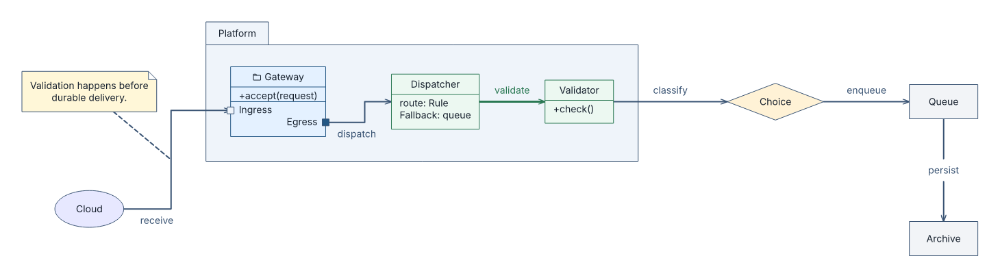
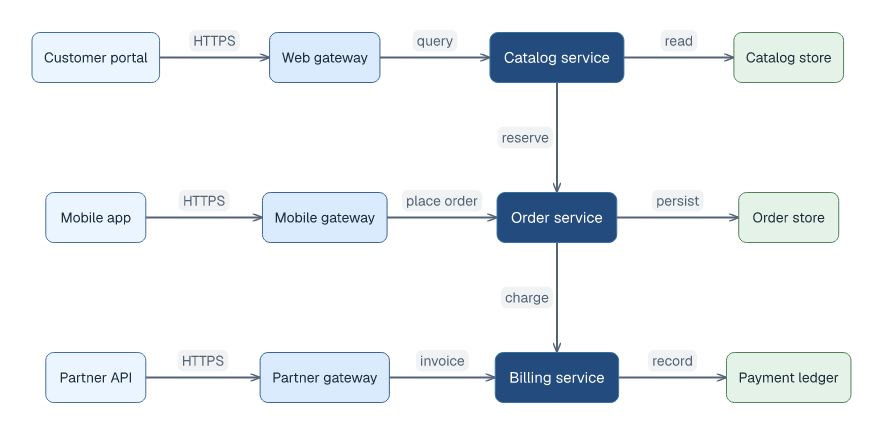
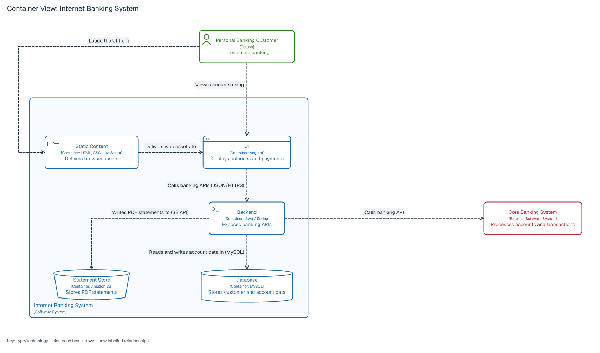
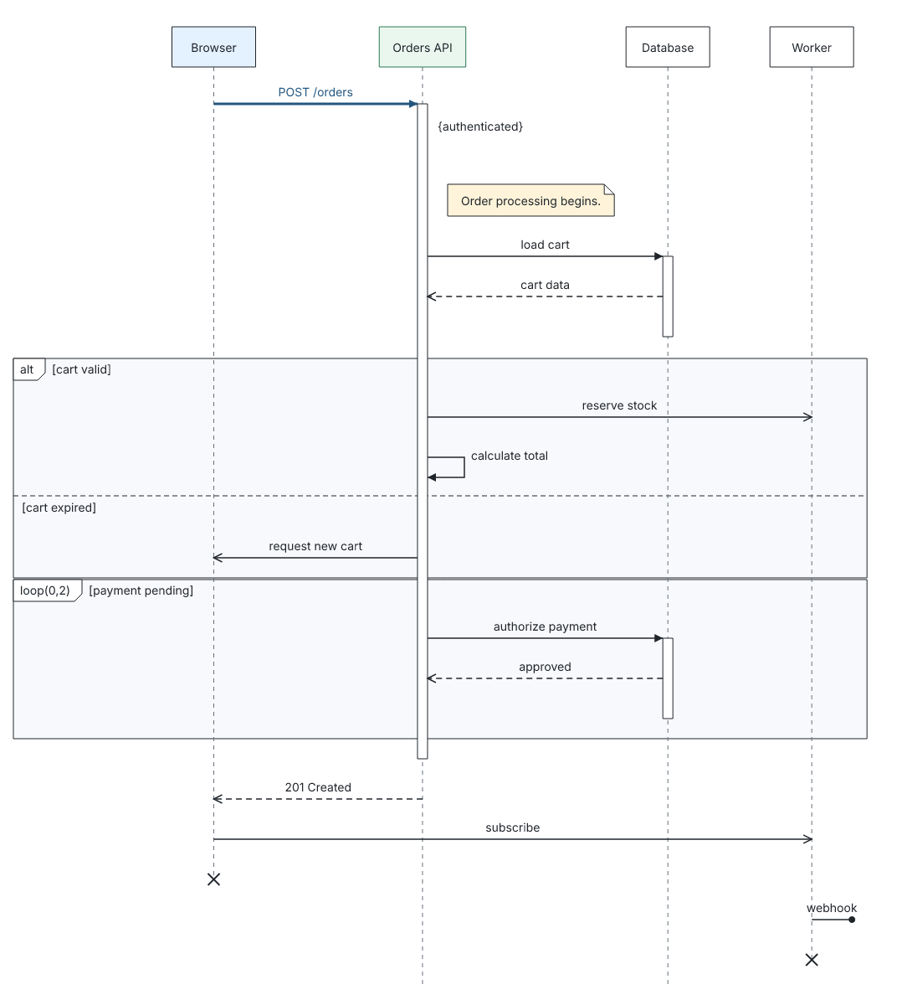
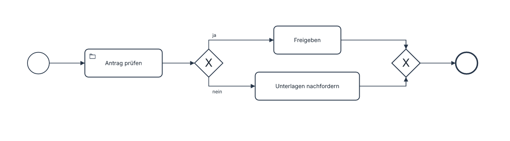

# LAML

## LAML - Diagrams for People

LAML turns a `.laml` file into an SVG, PNG or vector PDF diagram. Describe the elements, add only the placement rules that matter, and style the result independently.



[Source for this image](examples/showcase-generic.laml) · [Getting started](docs/getting-started.md)

## What is LAML?

LAML is a diagram language and compiler for architecture drawings, the four C4 zoom levels, 14 UML diagram types and a checked subset of BPMN process/collaboration diagrams. Its source separates **semantics** (what connects), **layout** (where things must go), and **styling** (how they look). It produces an image from the current source; it does not need a drawing editor or previous layout state.

## Why LAML?

### LAML treats layout as authored intent, not an accident of rendering!

A diagram can be technically correct and still fail the people who need to read it. An architect changes one service, rebuilds the image, and suddenly familiar elements have moved. A decision-maker comparing two versions can no longer see what actually changed. The diagram is too wide for the document, or its colors and typography look nothing like the surrounding pages.

Text-to-diagram tools make it easy to describe connections, but often leave the placement to the renderer. For architecture documents, **layout is part of the communication**: the same systems should stay in recognizable positions across diagrams, and a small edit should not force readers to relearn the picture.

LAML gives you three separate controls:

- **Semantics:** declare the elements and relationships that give the diagram its meaning.
- **Layout:** specify the positions and alignments that must hold; let LAML place the rest and route connections safely. Conflicting mandatory rules fail rather than being silently ignored.
- **Styling:** use CSS-like LAML Style Sheets to make the image fit the document.

Not every architecture picture is UML. **Generic node-edge (GNE) diagrams** let you combine shapes, ports, notes, relationships and styles without UML notation rules. The [architecture example](#architecture-placement-and-color) shows placement and styling in a buildable source; the [GNE guide](docs/diagrams/gne.md) shows the available elements.

## Installing & getting started

Linux and macOS:

```sh
curl -fsSL https://raw.githubusercontent.com/farion/laml/main/scripts/install.sh | sh
```

Windows (PowerShell):

```powershell
irm https://raw.githubusercontent.com/farion/laml/main/scripts/install.ps1 | iex
```

Installers select the platform, verify the downloaded archive against `SHA256SUMS`, and install without administrator privileges. Checksums are not digital signatures; inspect downloaded scripts before piping them to a shell if required by your security policy. Alternatively, use the archives from the published releases.

**Next:** [Getting started — first build, core concepts, and all diagram types](docs/getting-started.md).

## Basic examples

Each image comes from its linked, complete `.laml` source. The short code blocks below are excerpts, not standalone files.

### Architecture: placement and color

```laml
// Selected lines from examples/architecture.laml
semantics {
    // […]
    Browser -> WebEdge : HTTPS
    WebEdge -> Catalog : query
    // […]
}
layout {
    Browser < WebEdge : align=center; gap=110
    // […]
}
styling {
    node.service {
        fill: rgb(35, 75, 125)
        color: rgb(255, 255, 255)
    }
    // […]
}
```

[Open the complete source](examples/architecture.laml) to build the image.



### C4: a system boundary, containers and technologies

```laml
// Selected lines from examples/c4-banking-container.laml
settings {
    type: c4-container
    scope: Banking
}
semantics {
    system Banking(label="Internet Banking System"; description="Digital banking for customers") {
        container UI(label="UI"; technology="Angular"; appearance="browser"; description="Displays balances and payments")
        // […]
        container Database(label="Database"; technology="MySQL"; appearance="database"; description="Stores customer and account data")
    }
    // […]
}
```



[Full container source](examples/c4-banking-container.laml) · [Context, component and code views](docs/c4-diagrams.md). **C4 support is currently on `main`; the latest tagged binary does not include it yet.** Adapted from Simon Brown's [Internet Banking System example](https://c4model.com/example/) (CC BY 4.0).

### Class diagram: UML relationships

```laml
// Selected lines from examples/showcase-class.laml
semantics {
    // […]
    @owns Domain.Order "1" *-- "1..*" Domain.Line
    @placed Domain.Customer "1"/customer -- "0..*"/+orders Domain.Order : places
    // […]
}
```


[Full class source](examples/showcase-class.laml) · [Class guide](docs/diagrams/class.md)

### Sequence diagram: interactions over time

```laml
// Selected lines from examples/showcase-sequence.laml
semantics {
    // […]
    @request Browser -> API+ : POST /orders
    at[request.receive] : invariant="authenticated"
    @lookup API -> DB+ : load cart
    @found API <-- DB : cart data
    // […]
}
```



[Full showcase source](examples/showcase-sequence.laml) · [Sequence guide](docs/diagrams/sequence.md).

### BPMN: paint a decision, keep the process readable

```laml
// Selected lines from examples/bpmn-basic.laml
Start --> Review("Antrag prüfen")
Review <X>@Complete Approve("Freigeben"):ja ; RequestDocuments("Unterlagen nachfordern"):nein
Approve --> <X>@Merge --> Done
RequestDocuments --> Merge
```



[Complete BPMN source](examples/bpmn-basic.laml) · [BPMN guide and coverage limits](docs/bpmn-diagrams.md).

## Features

- **20 diagram types** (GNE, four C4 levels, 14 UML types and BPMN):
  - [Generic node-edge (GNE)](docs/diagrams/gne.md)
  - [C4 system context, container, component and code](docs/c4-diagrams.md)
  - [Class](docs/diagrams/class.md)
  - [Object](docs/diagrams/object.md)
  - [Component](docs/diagrams/component.md)
  - [Deployment](docs/diagrams/deployment.md)
  - [State](docs/diagrams/state.md)
  - [Activity](docs/diagrams/activity.md)
  - [Use case](docs/diagrams/usecase.md)
  - [Package](docs/diagrams/package.md)
  - [Sequence](docs/diagrams/sequence.md)
  - [Communication](docs/diagrams/communication.md)
  - [Interaction overview](docs/diagrams/interaction-overview.md)
  - [Timing](docs/diagrams/timing.md)
  - [Composite structure](docs/diagrams/composite.md)
  - [Profile](docs/diagrams/profile.md)
  - [BPMN process/collaboration subset](docs/diagrams/bpmn.md)
- Automatic placement with mandatory corrections; BPMN currently supports relative ordering rules, not numeric gap/alignment options.
- Six themes, including monochrome and dark variants; `modern` is the default. Override colors with LSS `base-color` or individual paints, use a transparent background, and supply local font files when needed. [Themes and fonts](docs/themes.md).
- LSS styling with selectors, classes, local imports and per-element overrides.
- SVG with selectable text by default, PNG and vector PDF.
- `laml check` for source validation; `laml build` for measured geometry and image output.
- All 1,512 bundled Phosphor regular icons are discoverable with `laml icons [FILTER]`.

[Language reference](docs/language-reference.md) · [Behavioral contract](docs/language-definition.md)

## License

[MIT](LICENSE). Bundled fonts and optional icons have their own attribution: [Inter](assets/INTER-LICENSE.txt), [Geist](assets/GEIST-LICENSE.txt) and [Phosphor](assets/phosphor/README.md).
