# LAML

LAML is a diagram language and Rust compiler. A `.laml` source file produces one SVG, PNG, or PDF image. Relations describe the diagram; mandatory layout rules let the author control node positions without manually drawing them. Styling lives in LAML Style Sheets (LSS), either inline or in local imported files.

## Install the latest release

Linux and macOS (automatically selects x86-64 or Apple Silicon):

```sh
curl -fsSL https://raw.githubusercontent.com/farion/laml/main/scripts/install.sh | sh
```

Windows x86-64 (PowerShell):

```powershell
irm https://raw.githubusercontent.com/farion/laml/main/scripts/install.ps1 | iex
```

The installers fetch the latest **published** release over HTTPS, verify the archive against its `SHA256SUMS`, and install without administrator privileges. The shell installer uses `~/.local/bin` (override with `LAML_INSTALL_DIR`); the Windows installer uses `%LOCALAPPDATA%\Programs\laml`, adds it to the user PATH, and requires a new terminal. Checksums detect corruption; they are not digital signatures. Review any downloaded script before piping it to a shell if you need to audit it.

## Update behaviour

`laml --version` prints the installed version. `laml update` explicitly downloads and verifies the latest published release, then replaces the **running binary's installation**. On Windows the verified replacement is staged and applied after the process exits. A read-only or package-managed installation may require updating through its package manager instead.

Normal `laml check` and `laml build` invocations read a local update cache and never wait for the network. At most once every 24 hours a background process queries GitHub for the latest published version; a known newer version prints a brief notice on subsequent invocations. The app never downloads an update automatically. Set `LAML_NO_UPDATE_CHECK=1` to disable the background request and notices.

## Build

```sh
cargo run -- check examples/architecture.laml
cargo run -- build examples/architecture.laml
# writes examples/architecture.svg
cargo run -- build examples/architecture.laml examples/architecture.png
cargo run -- build examples/architecture.laml examples/architecture.pdf
```

`build` accepts an optional output path: `laml build FILE.laml [OUTPUT.svg|OUTPUT.png|OUTPUT.pdf]`. An omitted output path produces SVG. `check` validates syntax, references, styles, and directional placement cycles. `build` additionally validates measured geometry and routing before writing the SVG. If the mandatory rules or safe routing cannot be satisfied, it reports an error instead of writing an invalid image.

SVG defaults to embedded Inter Regular with selectable text; diagrams with abstract UML text also embed the matching Inter Italic face. `--svg-text=system` produces selectable SVG text without embedding the font; `--svg-text=paths` turns SVG text into glyph outlines. PNG uses a white background; PDF is vector and retains selectable text. The bundled Regular and Italic font faces share the license at [assets/INTER-LICENSE.txt](assets/INTER-LICENSE.txt).

## Examples

These four larger showcases cover generic, class, object and sequence diagrams. Focused component, deployment, state and activity examples follow below. Each has a source link. Click an image to inspect it at full size; the examples are executable `.laml` files built by LAML. Each also builds as SVG and vector PDF.

### Generic node-edge diagram · [source](examples/showcase-generic.laml)

[](docs/images/showcase-generic.png)

Scoped containers, rectangle/ellipse/diamond/note shapes, addressable members and boundary ports, deterministic routing, mandatory placement, inline labels, LSS selectors, an optional icon and a note attached to a named relation.

### UML class diagram · [source](examples/showcase-class.laml)

[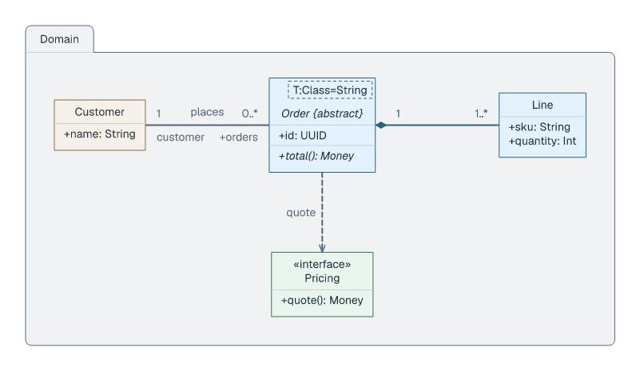](docs/images/showcase-class.png)

Classifier compartments, visibility and static/abstract notation, a dashed template corner, package grouping, composition and named association ends, box-form and compact-interface realizations, dependency, note-to-relation attachment, and a checked template binding. It illustrates the [supported UML notation subset](docs/uml-class-object-conformance.md), not a full UML model.

### UML object diagram · [source](examples/showcase-object.laml)

[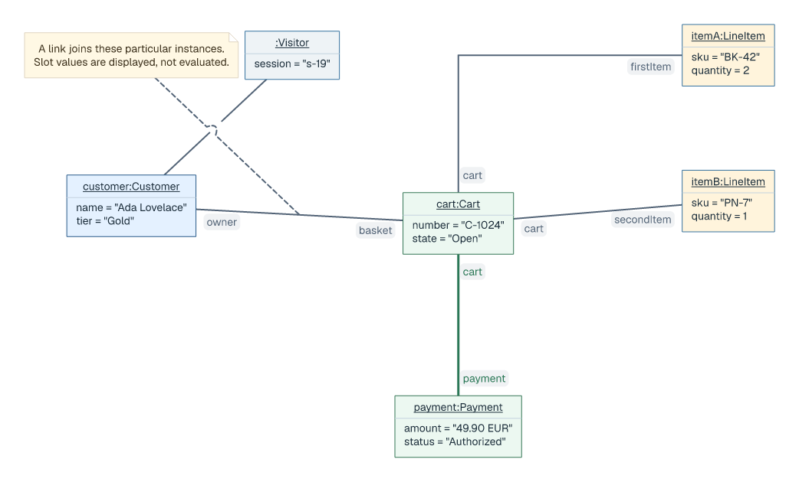](docs/images/showcase-object.png)

Typed and anonymous instances, literal slots, named link ends, scoped styling, and a note attached to a named link. Object links deliberately have no association multiplicities.

### UML sequence diagram · [source](examples/showcase-sequence.laml)

[](docs/images/showcase-sequence.png)

Executions, synchronous and asynchronous messages, replies, a self-call, alternative and bounded-loop frames, a note, time and duration annotations, an interaction use, a continuation and a lost message. Guards and values are displayed, not executed.

### Smaller focused examples

| [Architecture](examples/architecture.laml) | [Crossing](examples/crossing.laml) |
|---|---|
| [](examples/architecture.laml) | [](examples/crossing.laml) |
| Twelve nodes, four layers, service calls, local LSS import and mandatory layout. | A supported crossing with a bridge. |

| [Parallel relations and loop](examples/parallel-loops.laml) | [Relation-label modes](examples/label-modes.laml) |
|---|---|
| [](examples/parallel-loops.laml) | [](examples/label-modes.laml) |
| Distinct ports and an exterior self-loop. | Inline text with a per-relation along-path override. |

| [Sequence: calls and replies](examples/sequence-basic.laml) | [Sequence: alternative lifetimes](examples/sequence-alternative-births.laml) |
|---|---|
| [](examples/sequence-basic.laml) | [](examples/sequence-alternative-births.laml) |
| Lifelines, executions, messages and a `ref` frame. | The same participant ID has separate lifetime segments in two operands. |

| [Classes and association ends](examples/class-basic.laml) | [Object instances](examples/object-basic.laml) |
|---|---|
| [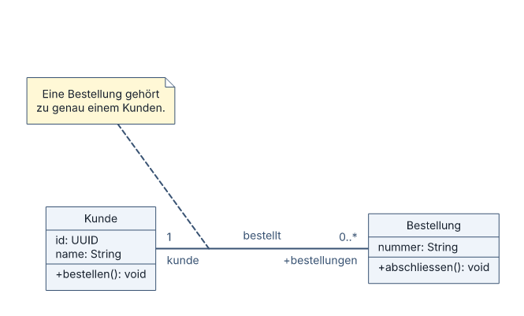](examples/class-basic.laml) | [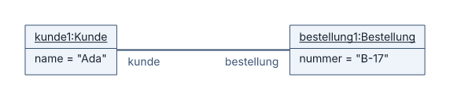](examples/object-basic.laml) |
| Typed classifiers, compartments, ends and note-to-edge attachment. | Underlined instances, slots and a link with end names. |

| [Named n-ary association](examples/class-nary.laml) | [Nested packages](examples/class-packages.laml) |
|---|---|
| [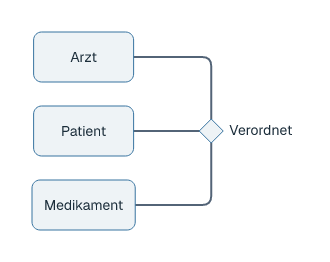](examples/class-nary.laml) | [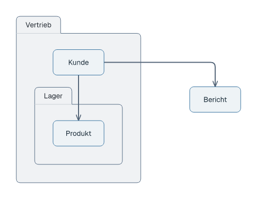](examples/class-packages.laml) |
| One association diamond, three arms. | Scoped names and contained geometry. |

| [Template binding](examples/class-binding.laml) | [Generic graph icons](examples/generic-icons.laml) |
|---|---|
| [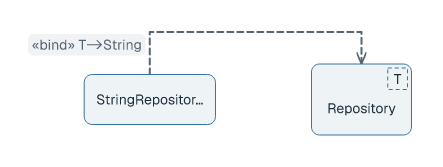](examples/class-binding.laml) | [](examples/generic-icons.laml) |
| Checked local substitution. | Optional Phosphor glyphs with conditional export attribution. |

| [Compact provided interfaces](examples/class-lollipops.laml) |
|---|
| [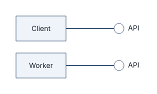](examples/class-lollipops.laml) |
| One empty interface, two distinct compact realizations. |

| [Component overview](examples/component-basic.laml) | [Component interfaces](examples/component-interfaces.laml) |
|---|---|
| [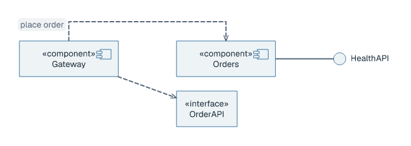](examples/component-basic.laml) | [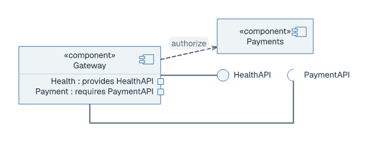](examples/component-interfaces.laml) |
| Dependencies and box-form/compact interfaces. | Explicit typed ports, lollipop and socket. |

| [Component internal wiring](examples/component-internal.laml) |
|---|
| [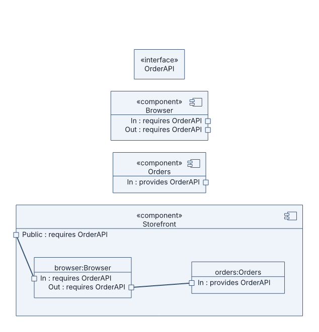](examples/component-internal.laml) |
| Simple ports on contained parts with distinct assembly and delegation notation. See the [component-diagram guide](docs/component-diagrams.md) and [UML notation audit](docs/uml-component-conformance.md). |

| [Deployment overview](examples/deployment-basic.laml) | [Nested topology](examples/deployment-topology.laml) |
|---|---|
| [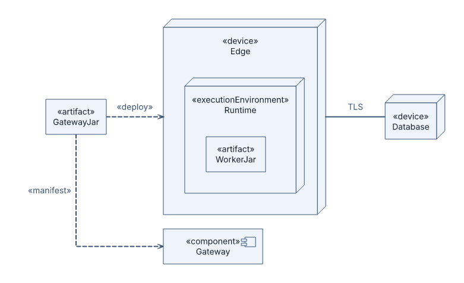](examples/deployment-basic.laml) | [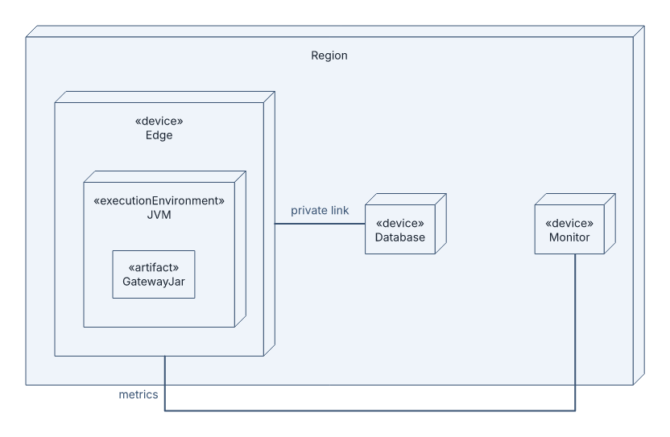](examples/deployment-topology.laml) |
| Device, environment, deployed artifact, communication path and separate `«deploy»`/`«manifest»` arrows. | Hierarchical node containment with bounded routes. |

| [Artifact manifestation](examples/deployment-manifest.laml) |
|---|
| [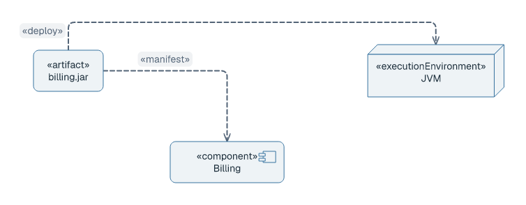](examples/deployment-manifest.laml) |
| Artifact-to-component manifestation is distinct from artifact-to-node deployment. See the [deployment-diagram guide](docs/deployment-diagrams.md) and [notation audit](docs/uml-deployment-conformance.md). |

| [States and choice](examples/state-basic.laml) | [Composite state](examples/state-composite.laml) |
|---|---|
| [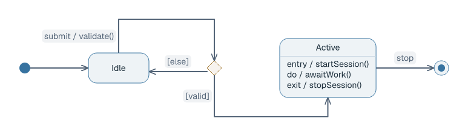](examples/state-basic.laml) | [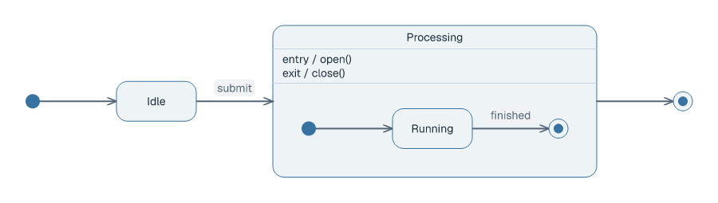](examples/state-composite.laml) |
| UML state vertices, guarded transitions and behavior text. | One visible nested region and an outer completion transition. |

| [State self-transition](examples/state-loop.laml) |
|---|
| [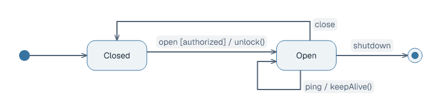](examples/state-loop.laml) |
| Event, guard and effect text with safe exterior routing. See the [state-diagram guide](docs/state-diagrams.md) and [UML notation audit](docs/uml-state-conformance.md). |

### UML activity diagram · [order example](examples/activity-order.laml)

[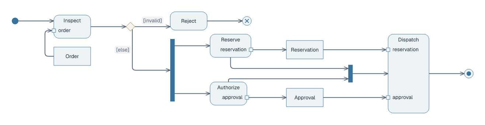](examples/activity-order.laml)

Control and object flows are distinct in the source but share UML's directed-arrow notation. Named input/output pins keep object flows attached to the action's data boundary; labels are not executed. See the [activity-diagram guide](docs/activity-diagrams.md) and [notation audit](docs/uml-activity-conformance.md).

Set `type: sequence` in `settings` to use the sequence grammar. Sequence diagrams use the same SVG/PNG/vector-PDF export commands; their node, message, fragment, annotation, gate and ordering visuals are styled with LSS. Start with the [sequence-diagram guide](docs/sequence-diagrams.md), then use the [syntax reference](docs/language-reference.md#sequence-diagrams) and [UML 2.5.1 notation audit](docs/uml-sequence-conformance.md). The outer UML `sd` interaction frame is intentionally deferred; divergent open executions at fragment joins are rejected rather than implicitly resolved.

Build any example with `cargo run -- build examples/NAME.laml`. The output filename selects the format (`.svg`, `.png`, or `.pdf`). SVG text modes are selected with `--svg-text=embedded|system|paths` after the optional output filename. The README images are generated with `cargo run -- build examples/NAME.laml docs/images/NAME.png`. Source files and matching images are tested together.

## Language feature contract

- Line-oriented `.laml` grammar for typed or generic graph nodes, named or unnamed directed/undirected relations, styling classes, labels, and diagram settings.
- Deterministic automatic placement; mandatory symbolic/word placement rules with minimum gaps and optional edge/centre alignment.
- Bounded node-safe routing with distinct parallel ports, exterior self-loops, and bridges at supported crossings; unsafe diagrams fail.
- Diagram-wide and per-relation label placement (`near`, `along`, `inline`).
- LSS styling and local recursive imports with a deterministic per-property cascade.
- SVG in embedded-font, system-font, or glyph-path text mode; PNG and vector PDF exports.
- Class and object diagram grammars with checked UML relationship notation, member compartments, instances and slots, associations, packages, qualifiers, notes, templates and addressable ports; unsupported combinations fail rather than silently drawing a different notation.
- Component diagrams with dependencies, provided/required interfaces, typed ports, contained parts and checked assembly/delegation connectors; no hidden UML model or runtime execution.
- Deployment diagrams with device/node cubes, execution environments, artifacts, nested deployment targets, solid communication paths and distinct checked `«deploy»`/`«manifest»` arrows.
- Behavior state diagrams with rounded states, initial/final and choice symbols, guarded transitions, entry/do/exit text and one-region composite states; strings are displayed, never executed.
- Activity diagrams with visible action pins and object nodes, explicit control/object flows, distinct decision/merge and fork/join, and activity/flow finals; no token execution.
- Generic node-edge shapes, nested containers, styled members, boundary ports, optional icons, named edge attachments and conditional icon-license metadata.
- Separate sequence grammar with lifelines, calls and replies, creation/deletion, fragments, interaction uses, annotations, coregions, inline part decompositions and mandatory layout constraints.
- `check`, `build`, and `update` commands, source-linked diagnostics, and conformance tests for deterministic and mandatory geometry.

## Releases

Pushing a stable version tag such as `v1.3.0` runs the [release workflow](.github/workflows/release.yml). The tag must match the version in `Cargo.toml` and point to a commit containing the workflow. All platform jobs must pass before publication. The GitHub Release contains archives for Linux x86-64, macOS Intel and Apple Silicon, Windows x86-64, and a `SHA256SUMS` file. Each archive contains the executable, example diagrams, README, and license files (including the separately attributed Inter and Phosphor assets).

Update `Cargo.toml` and `Cargo.lock`, commit those changes, then push the commit and its matching version tag. Moving an existing version tag is not part of the release process.

## Verification

```sh
cargo test --all-targets
cargo clippy --all-targets -- -D warnings
```

The test suite includes buildable examples, export formats, mandatory geometry, route safety, label placement, edit stability, and the 500-line-per-Rust-file rule.

## Documentation

- [Getting started](docs/getting-started.md)
- [Language reference](docs/language-reference.md)
- [Language contract](docs/language-definition.md)
- [Sequence-diagram guide](docs/sequence-diagrams.md)
- [Class and object diagram guide](docs/class-object-diagrams.md)
- [Component-diagram guide](docs/component-diagrams.md)
- [Deployment-diagram guide](docs/deployment-diagrams.md)
- [State-diagram guide](docs/state-diagrams.md)
- [UML state-machine notation audit and limits](docs/uml-state-conformance.md)
- [Activity-diagram guide](docs/activity-diagrams.md)
- [UML activity notation audit and limits](docs/uml-activity-conformance.md)
- [UML deployment notation audit and limits](docs/uml-deployment-conformance.md)
- [UML component notation audit and limits](docs/uml-component-conformance.md)
- [UML class/object notation audit and limits](docs/uml-class-object-conformance.md)
