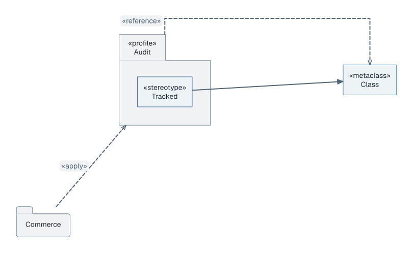

# LAML

LAML turns a `.laml` file into an SVG, PNG or vector PDF diagram. Describe the elements, add only the placement rules that matter, and style the result independently.


[Source for this image](examples/showcase-generic.laml) · [Getting started](docs/getting-started.md)

## What is LAML?

LAML is a diagram language and compiler for architecture drawings and 14 UML diagram types. Its source separates **semantics** (what connects), **layout** (where things must go), and **styling** (how they look). It produces an image from the current source; it does not need a drawing editor or previous layout state.

## Why LAML?

Relations describe connections; `layout` separately states which positions must hold. In this example, the source fixes four nodes in a grid while their two relations cross:

```laml
// Excerpts from examples/crossing.laml
semantics {
    // […]
    first: A -> D
    second: B -> C
}
layout {
    A < B : align=top; gap=120
    C < D : align=top; gap=120
    A above C : align=left; gap=120
    B above D : align=left; gap=120
}
```

The minimum gaps and alignments are mandatory. LAML routes the crossing with a visible bridge; if it cannot satisfy the placement and routing safely, the build fails:


[Code that builds this image](examples/crossing.laml) · [Placement and routing explained](docs/diagrams/gne.md#placement-and-routing).

## Installing & getting started

Linux and macOS:

```sh
curl -fsSL https://raw.githubusercontent.com/farion/laml/main/scripts/install.sh | sh
```

Windows (PowerShell):

```powershell
irm https://raw.githubusercontent.com/farion/laml/main/scripts/install.ps1 | iex
```

Installers select the platform, verify the downloaded archive against `SHA256SUMS`, and install without administrator privileges. Checksums are not digital signatures; inspect downloaded scripts before piping them to a shell if required by your security policy. Alternatively, use the archives from the published releases.

**Next:** [Getting started — first build, core concepts, and all diagram types](docs/getting-started.md).

## Basic examples

Each image comes from its linked, complete `.laml` source. The short code blocks below are excerpts, not standalone files.

### Architecture: placement and color

```laml
// Selected lines from examples/architecture.laml
semantics {
    // […]
    Browser -> WebEdge : HTTPS
    WebEdge -> Catalog : query
    // […]
}
layout {
    Browser < WebEdge : align=center; gap=110
    // […]
}
styling {
    node.service {
        fill: rgb(35, 75, 125)
        color: rgb(255, 255, 255)
    }
    // […]
}
```

[Open the complete source](examples/architecture.laml) to build the image.


### Class diagram: UML relationships

```laml
// Selected lines from examples/showcase-class.laml
semantics {
    // […]
    @owns Domain.Order "1" *-- "1..*" Domain.Line
    @placed Domain.Customer "1"/customer -- "0..*"/+orders Domain.Order : places
    // […]
}
```


[Full class source](examples/showcase-class.laml) · [Class guide](docs/diagrams/class.md)

### Sequence diagram: interactions over time

```laml
// Selected lines from examples/showcase-sequence.laml
semantics {
    // […]
    @request Browser -> API+ : POST /orders
    at[request.send] : time-observation="t0"
    @lookup API -> DB+ : load cart
    @found API <-- DB : cart data
    // […]
}
```


[Full showcase source](examples/showcase-sequence.laml) · [Sequence guide](docs/diagrams/sequence.md).

### Profile diagram: specialized UML notation

```laml
// Excerpt from examples/profile-audit.laml (semantics)
profile Audit {
    stereotype Tracked
}
metaclass Class
Audit.Tracked --^> Class
```



[Full source](examples/profile-audit.laml) · [Profile guide](docs/diagrams/profile.md)

## Features

- Generic node-edge diagrams plus [14 UML diagram types](docs/getting-started.md#diagram-types).
- Automatic placement with mandatory separation and alignment rules; measured routing and labels.
- LSS styling with selectors, classes, local imports and per-element overrides.
- SVG with selectable text by default, PNG and vector PDF.
- `laml check` for source validation; `laml build` for measured geometry and image output.

[Language reference](docs/language-reference.md) · [Behavioral contract](docs/language-definition.md)

## License

[MIT](LICENSE). Bundled fonts and optional icons have their own attribution: [Inter](assets/INTER-LICENSE.txt) and [Phosphor](assets/phosphor/README.md).
