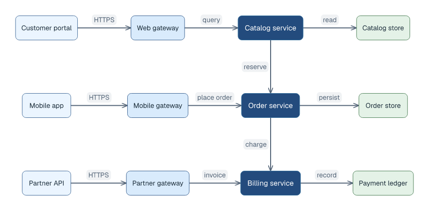
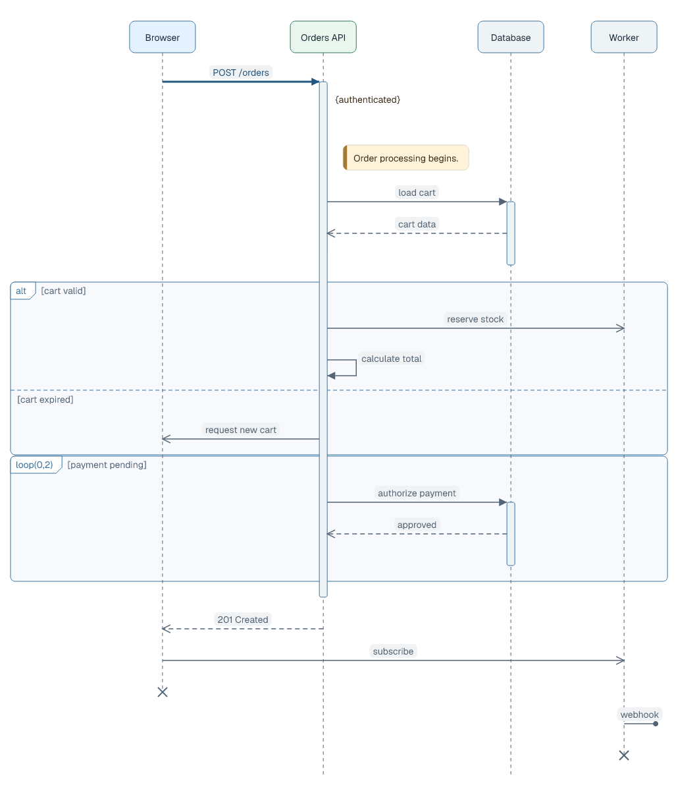

# LAML

Layout and Markup Language

<p>
  <a href="docs/diagrams/gne.md"><picture><source media="(prefers-color-scheme: dark)" srcset="docs/images/badge-generic-dark.svg"></picture></a>
  <a href="#uml"><picture><source media="(prefers-color-scheme: dark)" srcset="docs/images/badge-uml-dark.svg"></picture></a>
  <a href="#bpmn"><picture><source media="(prefers-color-scheme: dark)" srcset="docs/images/badge-bpmn-dark.svg"></picture></a>
  <a href="#c4"><picture><source media="(prefers-color-scheme: dark)" srcset="docs/images/badge-c4-dark.svg"></picture></a>
</p>

## Contents

- [What is LAML?](#what-is-laml)
- [Why LAML?](#why-laml)
- [Installing & getting started](#installing--getting-started)
- [Basic examples](#basic-examples)
- [Themes](#themes)
- [Features and diagram types](#features)
- [Import existing diagrams](#import-existing-diagrams)
- [AI agents via MCP](#ai-agents-via-mcp)
- [License](#license)

## LAML - Diagrams for People

LAML turns a `.laml` file into an SVG, PNG or vector PDF diagram. Describe the elements, add only the placement rules that matter, and style the result independently.

<picture>
  <source media="(prefers-color-scheme: dark)" srcset="docs/images/showcase-generic-modern-dark.png?v=orthogonal-default-20261104">
  
</picture>

[Source for this image](examples/showcase-generic.laml) · [Getting started](docs/getting-started.md)

## What is LAML?

LAML is a diagram language and compiler for architecture drawings, the four C4 zoom levels, 14 UML diagram types and a checked subset of BPMN process/collaboration diagrams. Its source separates **semantics** (what connects), **layout** (where things must go), and **styling** (how they look). Each build derives its image directly from the current source.

## Why LAML?

### LAML treats layout as authored intent, not an accident of rendering!

A diagram can be technically correct and still fail the people who need to read it. An architect changes one service, rebuilds the image, and suddenly familiar elements have moved. A decision-maker comparing two versions can no longer see what actually changed. The diagram is too wide for the document, or its colors and typography look nothing like the surrounding pages.

Text-to-diagram tools make it easy to describe connections, but often leave the placement to the renderer. For architecture documents, **layout is part of the communication**: the same systems should stay in recognizable positions across diagrams, and a small edit should not force readers to relearn the picture.

LAML gives you three separate controls:

- **Semantics:** declare the elements and relationships that give the diagram its meaning.
- **Layout:** specify the positions and alignments that must hold; let LAML place the rest and route connections safely. Connectors are orthogonal by default; `allow-diagonal: true` in `settings` opts into free routing. Conflicting mandatory rules fail rather than being silently ignored.
- **Styling:** use CSS-like LAML Style Sheets to make the image fit the document.

**Generic node-edge (GNE) diagrams** combine shapes, ports, notes, relationships and styles for architecture drawings. The [architecture example](#architecture-placement-and-color) shows placement and styling in a buildable source; the [GNE guide](docs/diagrams/gne.md) shows the available elements.

## Installing & getting started

Linux and macOS:

```sh
curl -fsSL https://raw.githubusercontent.com/farion/laml/main/scripts/install.sh | sh
```

Windows (PowerShell):

```powershell
irm https://raw.githubusercontent.com/farion/laml/main/scripts/install.ps1 | iex
```

Installers select the platform, check the downloaded archive against `SHA256SUMS`, and install in your user directory. For environments requiring signed provenance, apply your organization's verification policy before running downloaded scripts. Release archives are also available for manual installation.

**Next:** [Getting started — first build, core concepts, and all diagram types](docs/getting-started.md). To create and render diagrams from a local coding agent, see [OpenCode and Claude Code via MCP](docs/mcp.md).

## Basic examples

Each image links to its complete, buildable `.laml` source. The short code blocks below highlight selected lines.

### Architecture: placement and color

```laml
// Selected lines from examples/architecture.laml
semantics {
    // […]
    Browser -> WebEdge : HTTPS
    WebEdge -> Catalog : query
    // […]
}
layout {
    Browser < WebEdge : align=center; gap=110
    // […]
}
styling {
    node.service {
        fill: rgb(35, 75, 125)
        color: rgb(255, 255, 255)
    }
    // […]
}
```

[Open the complete source](examples/architecture.laml) to build the image.

<picture>
  <source media="(prefers-color-scheme: dark)" srcset="docs/images/architecture-modern-dark.png">
  
</picture>

### C4: a system boundary, containers and technologies

```laml
// Selected lines from examples/c4-banking-container.laml
settings {
    type: c4-container
    scope: Banking
}
semantics {
    system Banking(label="Internet Banking System"; description="Digital banking for customers") {
        container UI(label="UI"; technology="Angular"; appearance="browser"; description="Displays balances and payments")
        // […]
        container Database(label="Database"; technology="MySQL"; appearance="database"; description="Stores customer and account data")
    }
    // […]
}
```

<picture>
  <source media="(prefers-color-scheme: dark)" srcset="docs/images/c4-banking-container-modern-dark.png?v=orthogonal-default-20261104">
  
</picture>

[Full container source](examples/c4-banking-container.laml) · [Context, component and code views](docs/c4-diagrams.md). Adapted from Simon Brown's [Internet Banking System example](https://c4model.com/example/) (CC BY 4.0).

### Class diagram: UML relationships

```laml
// Selected lines from examples/showcase-class.laml
semantics {
    // […]
    @owns Domain.Order "1" *-- "1..*" Domain.Line
    @placed Domain.Customer "1"/customer -- "0..*"/+orders Domain.Order : places
    // […]
}
```

<picture>
  <source media="(prefers-color-scheme: dark)" srcset="docs/images/showcase-class-modern-dark.png">
  
</picture>

[Full class source](examples/showcase-class.laml) · [Class guide](docs/diagrams/class.md)

### Sequence diagram: interactions over time

```laml
// Selected lines from examples/showcase-sequence.laml
semantics {
    // […]
    @request Browser -> API+ : POST /orders
    at[request.receive] : invariant="authenticated"
    @lookup API -> DB+ : load cart
    @found API <-- DB : cart data
    // […]
}
```

<picture>
  <source media="(prefers-color-scheme: dark)" srcset="docs/images/showcase-sequence-modern-dark.png">
  
</picture>

[Full showcase source](examples/showcase-sequence.laml) · [Sequence guide](docs/diagrams/sequence.md).

### BPMN: paint a decision, keep the process readable

```laml
// Selected lines from examples/bpmn-basic.laml
Start --> Review("Antrag prüfen")
Review <X>@Complete Approve("Freigeben"):ja ; RequestDocuments("Unterlagen nachfordern"):nein
Approve --> <X>@Merge --> Done
RequestDocuments --> Merge
```

<picture>
  <source media="(prefers-color-scheme: dark)" srcset="docs/images/bpmn-basic-modern-dark.png?v=ea7813c">
  
</picture>

[Complete BPMN source](examples/bpmn-basic.laml) · [BPMN guide and coverage limits](docs/bpmn-diagrams.md).

## Themes

Six themes come in three light/dark pairs. The previews below have **transparent backgrounds** and switch with GitHub's light or dark appearance. Theme colors are chosen at build time, with separate images for light and dark backgrounds. The [theme guide](docs/themes.md) compares all six themes and explains fonts, `base-color`, and LSS overrides.

### Plain · Plain dark

<picture>
  <source media="(prefers-color-scheme: dark)" srcset="docs/images/theme-plain-dark.png?v=orthogonal-default-20261104">
  
</picture>

[Plain source](examples/theme-plain.laml) · [Plain dark source](examples/theme-plain-dark.laml)

### Modern · Modern dark

<picture>
  <source media="(prefers-color-scheme: dark)" srcset="docs/images/theme-modern-dark.png?v=orthogonal-default-20261104">
  
</picture>

[Modern source](examples/theme-modern.laml) · [Modern dark source](examples/theme-modern-dark.laml)

### Modern mono · Modern mono dark

<picture>
  <source media="(prefers-color-scheme: dark)" srcset="docs/images/theme-modern-mono-dark.png?v=orthogonal-default-20261104">
  
</picture>

[Modern mono source](examples/theme-modern-mono.laml) · [Modern mono dark source](examples/theme-modern-mono-dark.laml)

To render any example for both GitHub appearances, run `python3 scripts/build-theme-previews.py` after `cargo build --release`. This writes `docs/images/<name>-modern.png` and `docs/images/<name>-modern-dark.png` for every `.laml` source while keeping the originals intact. The dark export darkens explicit pale fills and brightens their dark borders and relation strokes in its temporary source, so authored light styling remains legible. GitHub selects the image with `<picture>` and `prefers-color-scheme`; the original example still builds normally with its own settings.

## Features

LAML supports **20 diagram types**: Generic node-edge, 14 UML types, four C4 levels and BPMN.

### Generic

- [Generic node-edge (GNE)](docs/diagrams/gne.md)

### UML

- [Class](docs/diagrams/class.md)
- [Object](docs/diagrams/object.md)
- [Component](docs/diagrams/component.md)
- [Deployment](docs/diagrams/deployment.md)
- [State](docs/diagrams/state.md)
- [Activity](docs/diagrams/activity.md)
- [Use case](docs/diagrams/usecase.md)
- [Package](docs/diagrams/package.md)
- [Sequence](docs/diagrams/sequence.md)
- [Communication](docs/diagrams/communication.md)
- [Interaction overview](docs/diagrams/interaction-overview.md)
- [Timing](docs/diagrams/timing.md)
- [Composite structure](docs/diagrams/composite.md)
- [Profile](docs/diagrams/profile.md)

### C4

- [System context](docs/c4-diagrams.md#system-context)
- [Container](docs/c4-diagrams.md#container)
- [Component](docs/c4-diagrams.md#component)
- [Code](docs/c4-diagrams.md#code)

### BPMN

- [Process](docs/bpmn-diagrams.md#first-process)
- [Collaboration](docs/bpmn-diagrams.md#collaboration-lanes-and-messages)

### Layout, styling and output

- Automatic placement with mandatory corrections; BPMN placement rules specify relative order.
- Six themes, including monochrome and dark variants; `modern` is the default. Override colors with LSS `base-color` or individual paints, use a transparent background, and supply local font files when needed. [Themes and fonts](docs/themes.md).
- LSS styling with selectors, classes, local imports and per-element overrides.
- SVG with selectable text by default, PNG and vector PDF.
- `laml check` for source validation; `laml build` for measured geometry and image output.
- `laml import` converts Mermaid, PlantUML and Structurizr diagram sources into editable LAML. [Import guide](docs/importing.md).
- All 1,512 bundled Phosphor regular icons are discoverable with `laml icons [FILTER]`.

[Language reference](docs/language-reference.md) · [Behavioral contract](docs/language-definition.md)

## Import existing diagrams

Convert Mermaid flowcharts, class and sequence diagrams; PlantUML class and sequence diagrams; or Structurizr C4 views into `.laml` source. For example:

```sh
laml import architecture.mmd
laml build architecture.laml architecture.svg
laml import workspace.dsl diagrams/
```

Structurizr produces one `.laml` file per view. The importer retains the source file and reports constructs requiring a separate mapping. See [import commands and supported syntax](docs/importing.md). The output is editable and can be built as SVG, PNG or PDF.

## AI agents via MCP

LAML includes a **local MCP server** in the CLI binary. A coding agent starts `laml mcp` over stdio, selects a diagram type, reads its notation, writes a `.laml` file in its workspace, and uses the compiler to render it.

The six tools cover discovery (`laml_types`), syntax (`laml_guide`, `laml_example`), diagram-specific relationships (`laml_relations`), quick source validation (`laml_check`), and SVG/PNG/PDF output with measured layout and routing validation (`laml_build`). Use `laml_build` to validate the finished diagram.

For example, register the server in your project with OpenCode:

```sh
opencode mcp add laml -- laml mcp
```

Or with Claude Code:

```sh
claude mcp add --transport stdio laml -- laml mcp
```

Then ask the agent to save a `.laml` file in the project and build an SVG. The agent needs access to the files it reads and writes. Although the LAML server runs locally, your chosen agent/model may send source content or tool results to an external provider. See the [MCP guide](docs/mcp.md) for configuration, workflow and access boundaries.

## License

[MIT](LICENSE). Bundled fonts and optional icons have their own attribution: [Inter](assets/INTER-LICENSE.txt), [Geist](assets/GEIST-LICENSE.txt) and [Phosphor](assets/phosphor/README.md).
