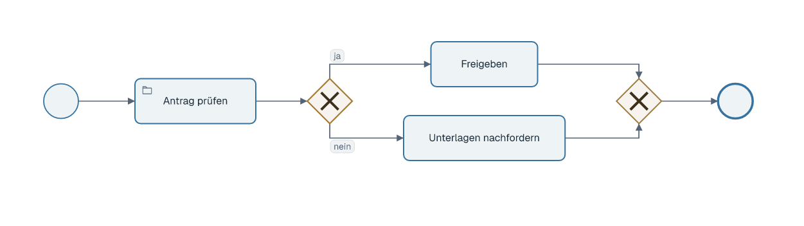
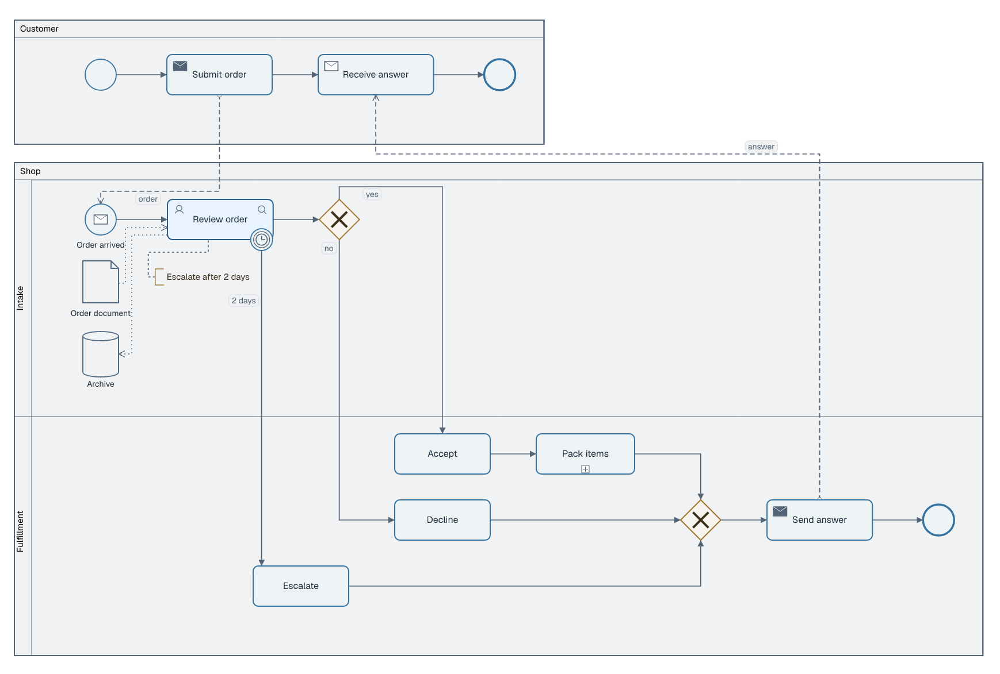
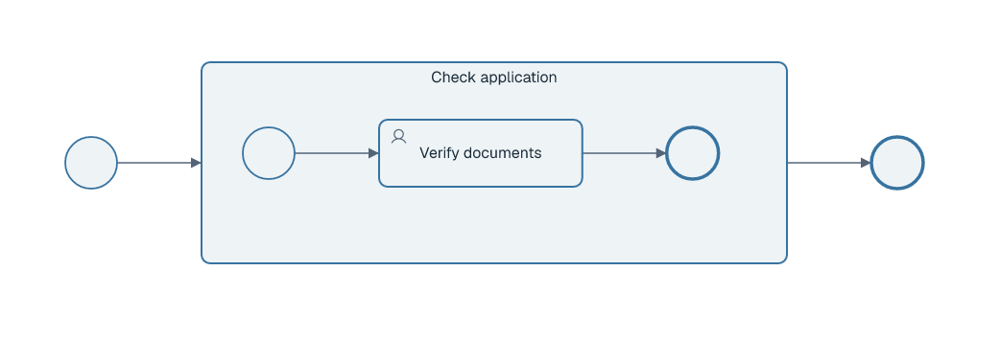
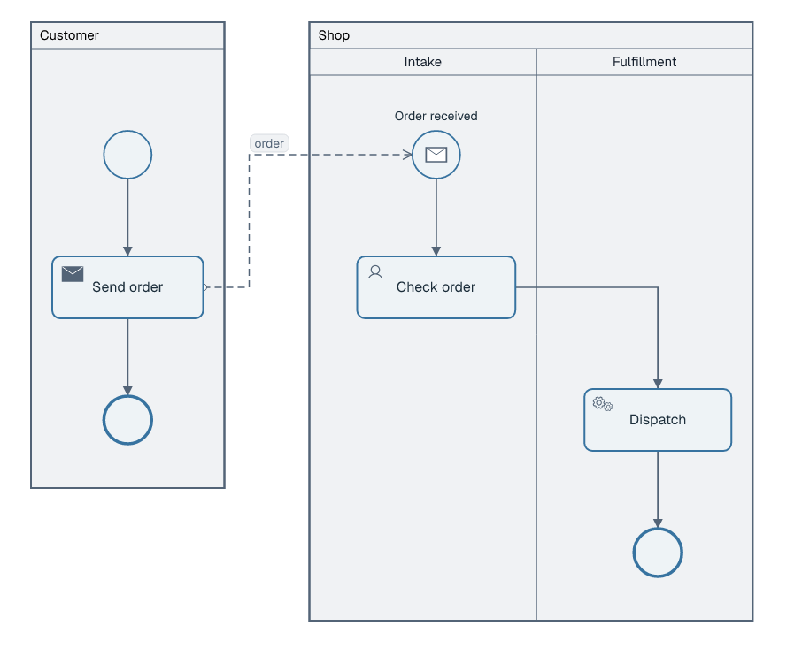

# BPMN diagrams

LAML draws a checked subset of BPMN process and collaboration notation. It does **not** import/export BPMN XML, run a process, check deadlocks or claim full BPMN conformance. Use an explicit source file; geometry is derived from current source and optional mandatory layout rules.

## First process

Copy to `process.laml` and run `laml build process.laml`. The complete source is also in [`examples/bpmn-basic.laml`](../examples/bpmn-basic.laml).

```text
settings {
    type: bpmn
}
semantics {
    startEvent Start
    endEvent Done
    Start --> Review(label="Antrag prüfen"; icon="folder")
    Review <X>@Complete Approve("Freigeben"):ja ; RequestDocuments("Unterlagen nachfordern"):nein
    Approve --> <X>@Merge --> Done
    RequestDocuments --> Merge
}
```



A bare identifier first encountered inside `semantics` creates an ordinary task. Optional `( ... )` text and attributes belong to the element at its *first* occurrence; later occurrences reference that element and cannot redefine it. `:ja` and `:nein` belong to the outgoing arrows. `<X>` draws an exclusive gateway, `<+>` a parallel gateway and `<O>` an inclusive gateway. `@Complete` and `@Merge` give gateways stable addresses; omitting a split's ID lets LAML derive one from the source line. An event-based gateway is `<event>` and must lead to catching intermediate events or receive tasks, not condition labels. Gateways are not freely replaceable icons.

## Collaboration, lanes and messages

The [complete collaboration source](../examples/bpmn-order.laml) and its image show two pools, two lanes, a boundary timer, task types, a data object and store, plus a collapsed subprocess:



```text
pool Customer("Customer") {
    startEvent Begin
    sendTask Submit("Submit order")
    Begin --> Submit
}
pool Shop("Shop") {
    lane Intake("Intake") {
        messageStart Received("Order arrived")
        userTask Review("Review order")
        Received --> Review
    }
}
Customer.Submit ~~> Shop.Received : order
```

The snippet above is **an excerpt within `semantics { ... }`**, not a whole source file. `-->` draws a sequence flow within a participant; `~~>` draws a dashed message flow **between distinct pools**; `..>` draws a dotted association involving `data` or `store`, never a process step. Pools and lanes are semantic membership: `layout` cannot move an element into another participant or lane. If a flow references an element in another lane, define that element in its own lane first, then use its ID. A process without pools is also valid.

## Events, subprocesses and data

Supported explicit event declarations: `startEvent`, `messageStart`, `timerStart`, `endEvent`, `messageEnd`, `errorEnd`, `terminateEnd`, `intermediateTimer`, `intermediateMessage`. Task types include bare tasks plus `userTask`, `serviceTask`, `sendTask`, `receiveTask`, `scriptTask` and `manualTask`. Unrecognized types fail rather than becoming generic drawing shapes.

Attach an interrupting timer, error or message event to a task or subprocess and draw its outgoing flow at the occurrence:

```text
Review -(timer@Deadline:"2 days")-> Escalate
Review -(error@Failure:"Failed")-> HandleError
Review -(message@Cancellation:"Cancel")-> Cancel
```

`timer+` and `message+` denote noninterrupting boundary events with dashed rings. The string is diagram text, not an evaluated timer expression. `data Order("Order document")` and `store Archive("Archive")` are associated with tasks using `Order ..> Review` and `Review ..> Archive`. A BPMN text annotation uses `note Policy("Escalate after 2 days")` and an undirected dashed association `Policy .. Review`; it is neither a data association nor a process step.

`+Check("Pack items")` draws a **collapsed** subprocess; `Check("Pack items") { ... }` draws its inner flow in a visibly **expanded** frame. These are alternative depictions, not two declarations of the same ID. Outer flows connect to the subprocess border, never directly to its inner nodes. See [`examples/bpmn-subprocess.laml`](../examples/bpmn-subprocess.laml):



## Layout and icons

Automatic layout is left-to-right. Pools appear one below another, lanes are ordered to put a lane containing a start event first. `direction: top-to-bottom` under `settings` rotates the automatic flow while keeping all node labels upright: pools become side-by-side and lanes become columns. Column width is measured from the actual widths of its nodes; nodes are centered inside the usable lane area, beyond its header. A pool without lanes does not reserve a phantom lane header. Message flows between side-by-side pools use the aisle rather than tracing a pool border; their labels keep clearance from both borders. In this direction, a start-event caption sits above the event when its outgoing sequence flow runs below. The [complete vertical source](../examples/bpmn-vertical.laml) produces this image:



A minimal mandatory correction uses distinct node addresses:

```text
layout {
    Review < Decision
    Decline below Approve
}
```

Contradictory rules fail. Layout directions (`<`, `>`, `above`, `below`) describe actual image coordinates even when the automatic flow is top-to-bottom. A manual rule cannot change pool, lane or subprocess membership. This BPMN renderer supports relative ordering; numeric gap and alignment constraints are not yet supported for BPMN.

By default, a gateway with up to four sequence flows assigns **a distinct cardinal docking point to each flow**. For the basic example, the split enters from the left and exits at the top (`ja`) and bottom (`nein`); the merge enters at the top and bottom and exits to the right. Automatic placement centers the straight-through path between the two branches; where unobstructed, each branch needs only one right-angle bend between its gateway and task. For cross-lane split/merge patterns, it may reorder unconstrained tasks within their own lane and assign join sides by that order to eliminate a crossing. Explicit layout and gateway docking rules take precedence. More than four flows are distributed at distinct points along the diamond's perimeter rather than sharing an anchor. Tasks, events, data objects, stores and notes also receive distinct attachments for their incident lines. The router considers distinct task/store attachment points as well as unobstructed orthogonal paths for each choice, including a lower-left task exit for data associations heading down and left. It tries sequence/message flows before supplementary connectors and compares alternative connector orders. Within those choices, it minimizes crossings first, then bend and length cost; it requires at least 20 pixels per bent segment (12 pixels at note/data brackets), avoids coincident segments, draws bridges at unavoidable crossings, and rejects drawings for which it cannot find a clear route rather than painting through a node. Annotation associations meet the visible bracket. All flow labels are placed after routing, close to their own line and clear of nodes, other lines, borders and other labels. Branch labels prefer the vicinity of their source gateway; ordinary flow labels favor the middle of their route instead of hugging either endpoint. A boundary-event caption such as `2 days` follows its outgoing flow and avoids the crowded side when another line runs beside it. Every pool has the same 30-pixel title header. Lane captions use a separate 30-pixel strip (30-pixel row in top-to-bottom diagrams). Bridges arc upward on horizontal lines and leftward on vertical lines, regardless of arrow direction. To override an individual gateway end, identify the flow by its endpoint IDs:

```text
layout {
    flow[Complete->Approve] : from=right
    flow[RequestDocuments->Merge] : to=left
    flow[Complete->RequestDocuments] : label-orientation=auto
    // For the Order example: flow[Decision->Decline] : label-orientation=vertical
}
```

`from` selects the exit side of a gateway; `to` selects its entry side. Options are `top`, `right`, `bottom`, `left`; both properties may be supplied, separated by `;`, when both ends are gateways. `label-orientation=auto|horizontal|vertical` selects the orientation of a sequence-flow label (or a boundary event's caption on its outgoing flow); `auto` is the default and prefers a clear horizontal placement close to the line. With a modern theme, flow labels have rounded, lightly outlined backgrounds; `plain` leaves them unboxed. BPMN labels and captions are sized to remain readable alongside the other diagram types. A forced orientation fails when the route has no suitable, unoccupied space. For example, `flow[Decision->Decline] : label-orientation=vertical` or `flow[Deadline->Escalate] : label-orientation=horizontal`; combine it with a gateway attachment as `flow[Complete->Approve] : from=right; label-orientation=vertical`. The bracket must identify exactly one sequence flow. Contradictory overrides (two flows on one cardinal point when there are four or fewer) fail during `check` and `build`. Attachments do not change the BPMN semantics.

LAML bundles the **complete 1,512-icon Phosphor regular catalogue**. Use `laml icons` for the list, `laml icons clock` to filter it, or see [`assets/phosphor/icons.txt`](../assets/phosphor/icons.txt). An icon on a task is illustrative; it never changes the task type. Task width reserves space for the label and the type/icon markers so they do not touch. The timer marker itself uses the bundled Phosphor `clock` SVG. SVG, PNG and PDF retain the existing hidden license metadata policy when icons are actually used.

BPMN styling currently supports `fill`, `border-color`, `base-color`, `color`, `icon` and `icon-set: phosphor` with normal LSS selectors/imports. Other style properties are rejected rather than silently ignored. Example:

```text
styling {
    node[Shop.Review] {
        fill: "#e8f3ff"
        border-color: "#285b85"
        icon: "magnifying-glass"
    }
}
```

## Coverage boundary

The current BPMN drawing subset does not include BPMN XML interchange, choreography/conversation diagrams, simulation, complex gateways, transactions, compensation, event subprocesses, multi-instance task markers or every event subtype. It aims to cover common *drawn* processes and collaborations while rejecting unsupported constructs. Read that boundary before using the diagrams as evidence of BPMN conformance.
