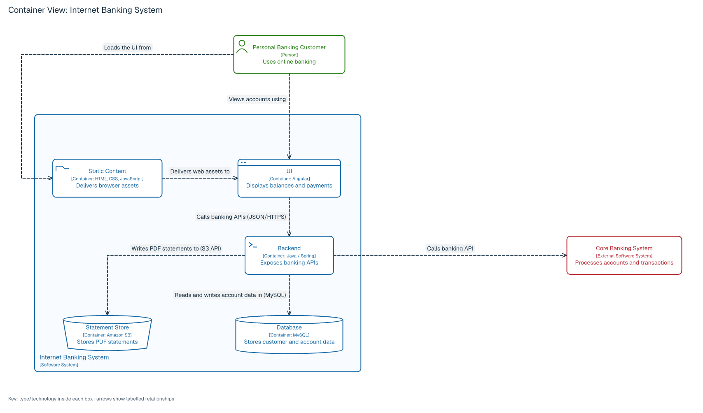
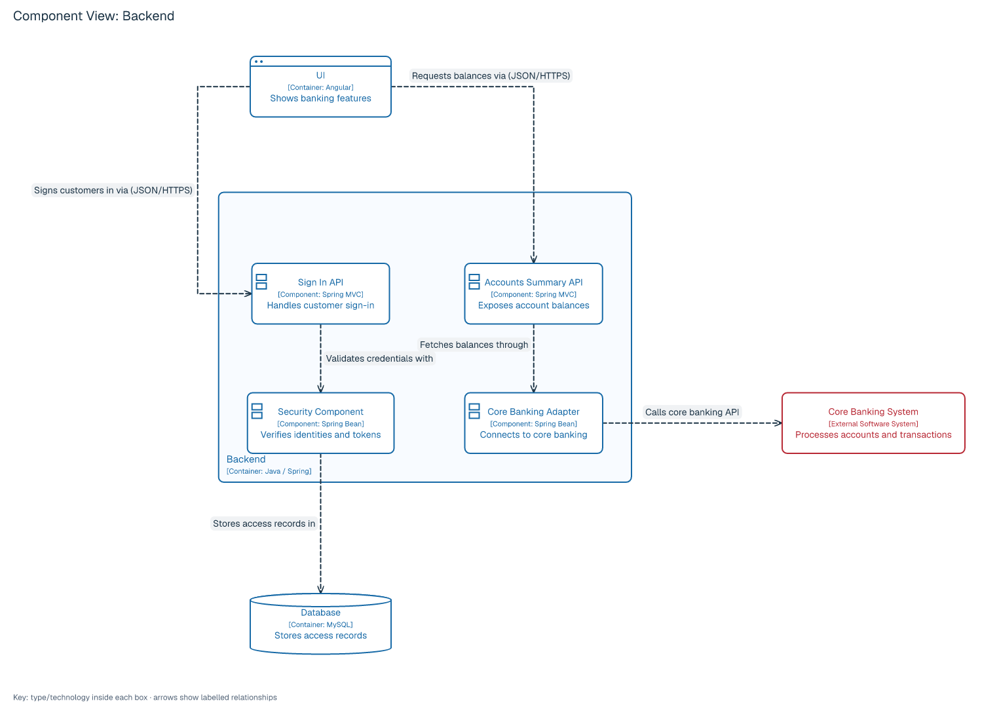
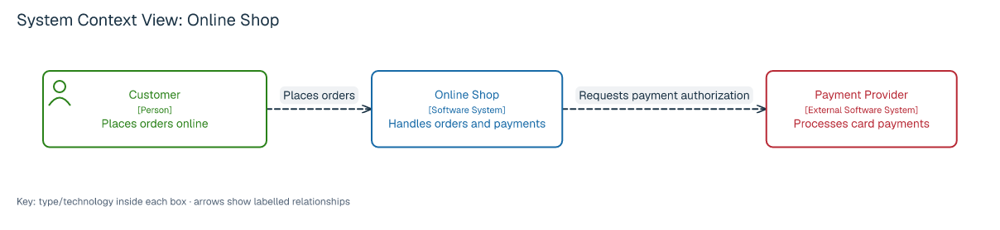
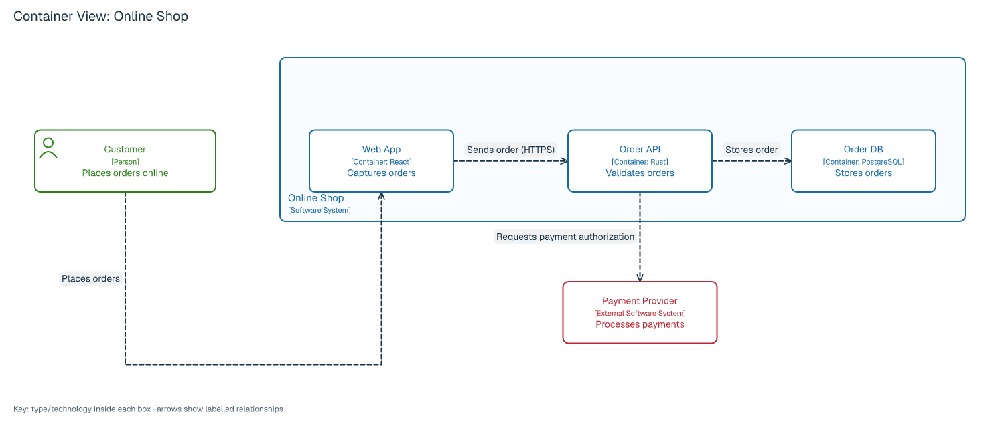
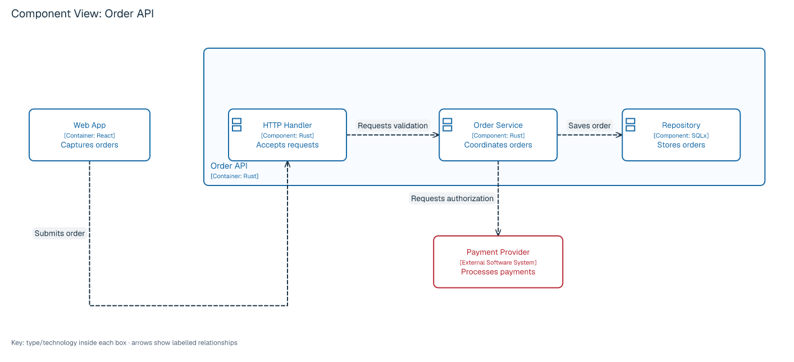
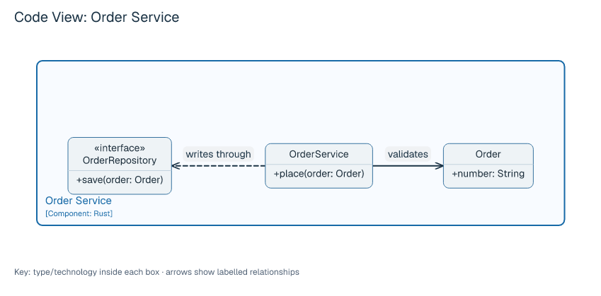

# C4 diagrams

LAML supports the four static C4 zoom levels with `type: c4-context`, `c4-container`, `c4-component`, and `c4-code`. Each file produces one image from its own source. There is no hidden architecture repository, automatic synchronisation between levels, code introspection, or process simulation. A C4 *container* is an application or data store, not necessarily a Docker container. C4 itself is notation-independent; the source forms below are LAML's notation for those views.

## Classic Internet Banking examples

These two examples demonstrate the C4 visual vocabulary: named scope boundaries, person and component icons, browser/terminal/storage shapes, visible technologies, directional dashed arrows, distinct colors for people and external systems, a title and a key. The source stays LAML: shapes are optional `appearance="browser|terminal|folder|database|bucket"` attributes on containers, not new element types. Users may override the colors with LSS. Long texts can use quoted `\\n` line breaks.

[Buildable container source](../examples/c4-banking-container.laml) · [Buildable component source](../examples/c4-banking-component.laml)





Adapted from Simon Brown's [Internet Banking System C4 example](https://c4model.com/example/) under [CC BY 4.0](https://creativecommons.org/licenses/by/4.0/); descriptions and layout are LAML adaptations, not copies of the original diagram files. The component example focuses on the Backend boundary; it does **not yet** draw an additional enclosing Internet Banking System boundary.

## System context

[Complete source](../examples/c4-context.laml) · [Rendered image](images/c4-context.png)

```laml
settings {
    type: c4-context
    scope: Shop
}
semantics {
    person Customer(label="Customer"; description="Places orders online")
    system Shop(label="Online Shop"; description="Handles orders and payments")
    external system Payment(label="Payment Provider"; description="Processes card payments")
    Customer -> Shop : Places orders
    Shop -> Payment : Requests payment authorization
}
layout {
    Customer < Shop : align=center; gap=90
    Shop < Payment : align=center; gap=90
}
```



The scoped software system is a box; people and directly connected external systems are supporting elements. The view intentionally omits technology details.

## Container

[Complete source](../examples/c4-container.laml) · [Rendered image](images/c4-container.png)



`scope: Shop` identifies the single `system Shop(...) { ... }` boundary. The block contains `container` declarations, each with a required `technology` and `description`. People and external systems remain outside it. Relations can use qualified endpoints such as `Shop.Web` and `Shop.API`. The named edge `@submit(technology="HTTPS") Shop.Web -> Shop.API : Sends order` shows the protocol visibly as `Sends order (HTTPS)`.

## Component

[Complete source](../examples/c4-component.laml) · [Rendered image](images/c4-component.png)



`scope: API` selects one `container API(...) { ... }` boundary containing `component` declarations. Each component has a description and technology. Peer containers, people and external systems may be shown as supporting elements. This is a C4 component, **not** a UML component with required/provided ports.

## Code

[Complete source](../examples/c4-code.laml) · [Rendered image](images/c4-code.png)



`scope: Orders` selects a `component Orders(...) { ... }` boundary. Inside it, `class`, `interface`, `enum` and `datatype` declarations use the existing UML class notation, including members and class relationships. This level is optional in C4; LAML does not derive it from source code or assert that the depicted classes exist in a repository.

## Rules and styling

- `settings` needs exactly one `type` and `scope`. The scoped element must appear exactly once, must not be external, and must be a system (box), system (boundary), container (boundary) or component (boundary), respectively.
- C4 people, systems, containers and components need a nonempty `description`. Containers and components also need `technology`. `label` and `style-classes` are optional. Text and technology are displayed in the image with an explicit element type.
- Context, container and component relations use labelled, directed `->` arrows. A named relation may add `technology="..."` to display a protocol. Code diagrams use UML class relationships instead.
- Only the scoped system/container/component has a declaration block (and context's system is a box without a block); C4 containers and components cannot be substituted by arbitrary generic graph nodes. The layout and LSS sections work as on other graph diagrams; in `layout`, refer to a contained element as `Scope.Element`.
- The default C4 rendering distinguishes people, internal elements and external systems, uses typed labels, titles/keys and dashed directed arrows. Optional `appearance` on containers selects a browser, terminal, folder, cylindrical database or bucket outline. LSS declarations override the default paints; geometry, labels and routing remain subject to the ordinary graph checks.
- The single component/code view is not inferred from the previous zoom level. Keep names aligned across separate files yourself. Any contradiction within a file should be rejected; cross-file consistency is the author's responsibility.

C4 guidance: [the four zoom levels](https://c4model.com/diagrams), [notation](https://c4model.com/diagrams/notation), [code diagrams](https://c4model.com/diagrams/code). For an equivalent container example in C4-PlantUML, compare its `Person(...)`, `System_Boundary(...)`, `Container(...)`, and `Rel(...)` macros with LAML's element declarations, boundary block and directed arrow.
