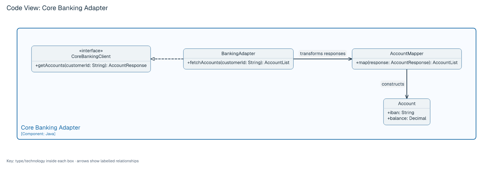
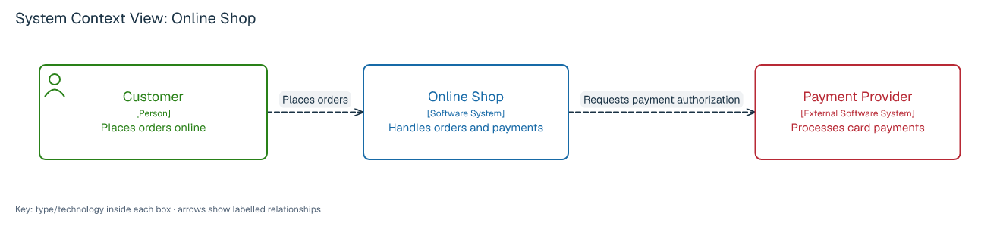
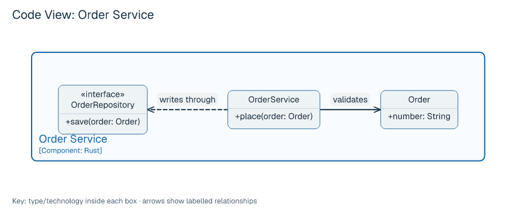

# C4 diagrams

LAML draws four C4 zoom levels with `type: c4-context`, `c4-container`, `c4-component`, and `c4-code`. Each file produces an image from its own source. A C4 *container* denotes an application or data store. The examples below show LAML's notation for these views.

## Internet Banking across four levels

These four buildable examples demonstrate the C4 visual vocabulary: named scope boundaries, person and component icons, browser/terminal/storage shapes, visible technologies, directional dashed arrows, distinct colors for people and external systems, a title and a key. Container shapes use optional `appearance="browser|terminal|folder|database|bucket"` attributes. Users may override the colors with LSS. Long texts can use quoted `\n` line breaks.

[Context source](../examples/c4-banking-context.laml) · [Container source](../examples/c4-banking-container.laml) · [Component source](../examples/c4-banking-component.laml) · [Code source](../examples/c4-banking-code.laml)

<picture>
  <source media="(prefers-color-scheme: dark)" srcset="images/c4-banking-context-modern-dark.png?v=ea7813c">
  
</picture>

<picture>
  <source media="(prefers-color-scheme: dark)" srcset="images/c4-banking-container-modern-dark.png?v=orthogonal-default-20261104">
  
</picture>

<picture>
  <source media="(prefers-color-scheme: dark)" srcset="images/c4-banking-component-modern-dark.png?v=ea7813c">
  
</picture>

<picture>
  <source media="(prefers-color-scheme: dark)" srcset="images/c4-banking-code-modern-dark.png">
  
</picture>

The context, container and component views adapt Simon Brown's [Internet Banking System C4 example](https://c4model.com/example/) under [CC BY 4.0](https://creativecommons.org/licenses/by/4.0/). Descriptions and layout are LAML adaptations. The component view shows both the scoped Backend and its enclosing Internet Banking System; its component inventory is curated for this example. The code view illustrates the next zoom level with a separate LAML example.

## System context

[Complete source](../examples/c4-context.laml) · [Rendered image](images/c4-context-modern.png)

```laml
settings {
    type: c4-context
    scope: Shop
}
semantics {
    person Customer(label="Customer"; description="Places orders online")
    system Shop(label="Online Shop"; description="Handles orders and payments")
    external system Payment(label="Payment Provider"; description="Processes card payments")
    Customer -> Shop : Places orders
    Shop -> Payment : Requests payment authorization
}
layout {
    Customer < Shop : align=center; gap=90
    Shop < Payment : align=center; gap=90
}
```

<picture>
  <source media="(prefers-color-scheme: dark)" srcset="images/c4-context-modern-dark.png">
  
</picture>

The scoped software system is a box; people and directly connected external systems are supporting elements. Technology details appear at the container level.

## Container

[Complete source](../examples/c4-container.laml) · [Rendered image](images/c4-container-modern.png?v=ea7813c)

<picture>
  <source media="(prefers-color-scheme: dark)" srcset="images/c4-container-modern-dark.png?v=ea7813c">
  
</picture>

`scope: Shop` identifies the single `system Shop(...) { ... }` boundary. The block contains `container` declarations, each with a required `technology` and `description`. People and external systems remain outside it. Relations can use qualified endpoints such as `Shop.Web` and `Shop.API`. The named edge `@submit(technology="HTTPS") Shop.Web -> Shop.API : Sends order` shows the protocol visibly as `Sends order (HTTPS)`.

## Component

[Complete source](../examples/c4-component.laml) · [Rendered image](images/c4-component-modern.png?v=ea7813c)

<picture>
  <source media="(prefers-color-scheme: dark)" srcset="images/c4-component-modern-dark.png?v=ea7813c">
  
</picture>

`scope: API` selects one `container API(...) { ... }` boundary containing `component` declarations. You may optionally enclose it and its peer containers in one `system Name { ... }` boundary, as in the banking example; the scope remains the container ID, and references use the full path (`Banking.Backend.SignIn`). Each component has a description and technology. Peer containers, people and external systems may be shown as supporting elements. C4 components carry their description and technology in this view.

## Code

[Complete source](../examples/c4-code.laml) · [Rendered image](images/c4-code-modern.png)

<picture>
  <source media="(prefers-color-scheme: dark)" srcset="images/c4-code-modern-dark.png">
  
</picture>

`scope: Orders` selects a `component Orders(...) { ... }` boundary. Inside it, `class`, `interface`, `enum` and `datatype` declarations use the existing UML class notation, including members and class relationships. The code view is authored as a separate diagram using the class notation.

## Rules and styling

- `settings` needs exactly one `type` and `scope`. The scoped element must appear exactly once, must not be external, and must be a system (box), system (boundary), container (boundary) or component (boundary), respectively.
- C4 people, systems, containers and components need a nonempty `description`. Containers and components also need `technology`. `label` and `style-classes` are optional. Text and technology are displayed in the image with an explicit element type.
- Context, container and component relations use labelled, directed `->` arrows. A named relation may add `technology="..."` to display a protocol. Code diagrams use UML class relationships instead.
- The scoped system, container or component owns its declaration block. At component level, an optional enclosing `system` boundary can contain the scoped container and peer containers. Layout and LSS use full element paths such as `Banking.Backend.SignIn` when nested.
- The default C4 rendering distinguishes people, internal elements and external systems, uses typed labels, titles/keys and dashed directed arrows. Optional `appearance` on containers selects a browser, terminal, folder, cylindrical database or bucket outline. LSS declarations override the default paints; geometry, labels and routing remain subject to the ordinary graph checks.
- Author each zoom level in its own file and keep names consistent across the series.

C4 guidance: [the four zoom levels](https://c4model.com/diagrams), [notation](https://c4model.com/diagrams/notation), [code diagrams](https://c4model.com/diagrams/code). For an equivalent container example in C4-PlantUML, compare its `Person(...)`, `System_Boundary(...)`, `Container(...)`, and `Rel(...)` macros with LAML's element declarations, boundary block and directed arrow.
