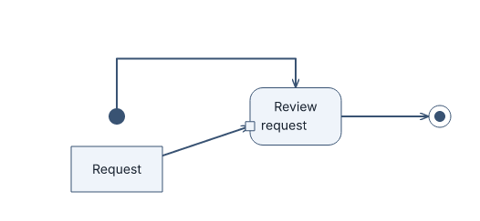
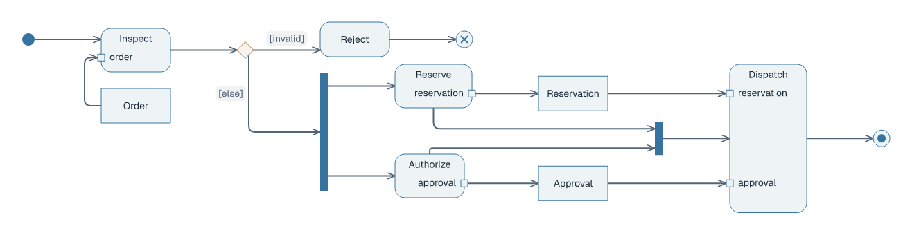

# Activity diagrams

## Basic example

```laml
settings {
    type: activity
}
semantics {
    initial Start
    objectNode Request
    action Review {
        input request
    }
    activityFinal Done

    object Request --> Review::request
    control Start --> Review
    control Review --> Done
}
```



[Complete source for this image](../../examples/activity-basic.laml). `object` carries a request to the action's named input pin; `control` connects the start, action and activity final.

## Decisions, parallel work and completion

```laml
// Excerpts from examples/activity-order.laml
semantics {
    // […]
    control Valid --> Reject : [invalid]
    @approved control Valid --> Parallel : [else]
    control Parallel --> Reserve
    control Parallel --> Authorize
    control Reserve --> Together
    control Authorize --> Together
    // […]
}
```



[Complete source](../../examples/activity-order.laml). A `decision` uses guarded outgoing paths; `fork` and `join` split and rejoin parallel paths. `flowFinal` ends one path, `activityFinal` ends the activity.

## More data flows

```laml
// Excerpts from examples/activity-order.laml
object Reserve::reservation --> Reservation
object Reservation --> Dispatch::reservation
object Authorize::approval --> Approval
object Approval --> Dispatch::approval
```


[Complete source](../../examples/activity-order.laml). `Action::pin` addresses an input or output pin. See [GNE](gne.md) for common placement/styling and the [syntax reference](../language-reference.md#activity-diagrams) for vertex and flow forms.
