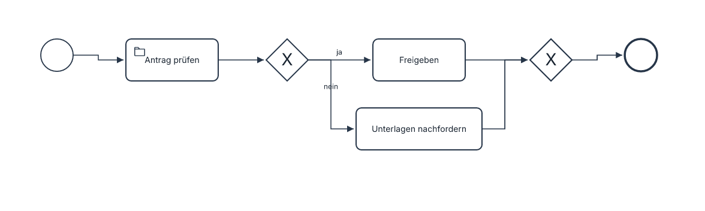

# BPMN process and collaboration diagrams

## Basic example

Save as `bpmn-basic.laml` and build with `laml build bpmn-basic.laml`:

```laml
settings {
    type: bpmn
}
semantics {
    startEvent Start
    endEvent Done
    Start --> Review(label="Antrag prüfen"; icon="folder")
    Review <X>@Complete Approve("Freigeben"):ja ; RequestDocuments("Unterlagen nachfordern"):nein
    Approve --> <X>@Merge --> Done
    RequestDocuments --> Merge
}
```



[Complete source](../../examples/bpmn-basic.laml). `<X>` draws an exclusive gateway directly in the flow; the branch labels sit on outgoing arrows. `@Complete` and `@Merge` are addresses for joins, layout and styling. A bare first occurrence creates a task.

For pools, lanes, messages, timers, data, expanded subprocesses, supported event and task types, icons, styling and coverage limits, see the [BPMN reference](../bpmn-diagrams.md). The [collaboration image](../images/bpmn-order.png) has [complete source](../../examples/bpmn-order.laml). The [expanded subprocess image](../images/bpmn-subprocess.png) has [complete source](../../examples/bpmn-subprocess.laml).
