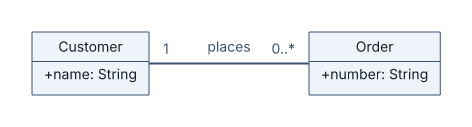
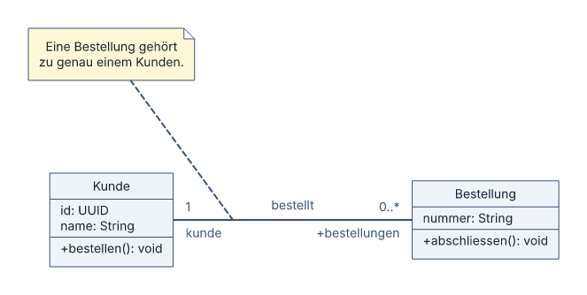
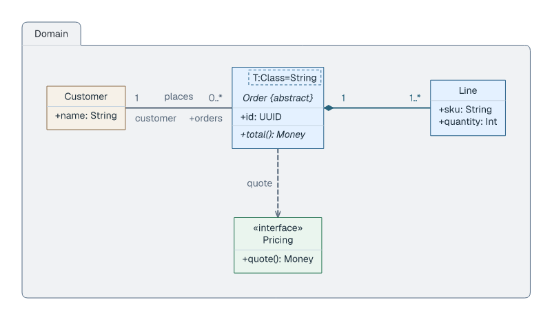
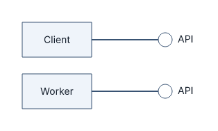
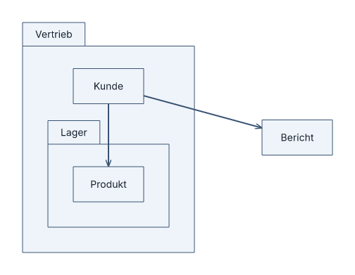
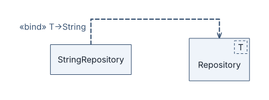
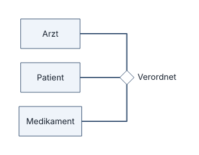
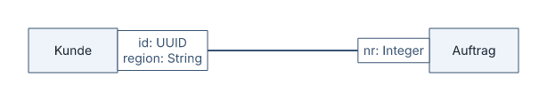
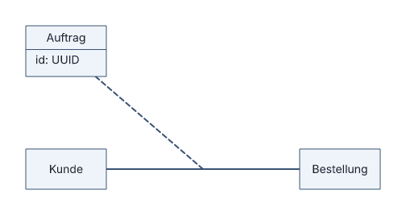

# Class diagrams

## Basic example

```laml
settings {
    type: class
}
semantics {
    class Customer {
        +name: String
    }
    class Order {
        +number: String
    }
    @places Customer "1" -- "0..*" Order : places
}
layout {
    Customer < Order : gap=160
}
```



[Complete source for this image](../../examples/class-quickstart.laml). `"1"` and `"0..*"` label the association ends; `layout` fixes the boxes' minimum separation.

## Members, notes and association ends

```laml
// Excerpts from examples/class-basic.laml
semantics {
    class Kunde {
        @kundenId id: UUID
        name: String
        --
        +void bestellen()
    }
    // […]
    @orders Kunde "1"/kunde -- "0..*"/+bestellungen Bestellung : bestellt
    // […]
    Regel .. relation[orders]
}
```



[Complete source](../../examples/class-basic.laml). `--` separates attributes and operations; `Regel .. relation[orders]` attaches a note to the named association.

## Classifiers and relationships

```laml
// Excerpts from examples/showcase-class.laml
semantics {
    package Domain {
        abstract class Order<T:Class=String>(style-classes=core) <<aggregate>> {
            @orderId +id: UUID
            // […]
        }
        // […]
    }
    // […]
    @placed Domain.Customer "1"/customer -- "0..*"/+orders Domain.Order : places
    @owns Domain.Order "1" *-- "1..*" Domain.Line
    @priced Domain.Order ..> Domain.Pricing : quote
    // […]
}
```



[Complete source](../../examples/showcase-class.laml). The excerpt illustrates notation; the complete source supplies declarations and layout.

| Form | Use |
|---|---|
| `class`, `abstract class`, `interface`, `enum`, `datatype` | Classifier notation. |
| `--`, `*--`, `..>`, `..|>` | Association, composition, dependency, realization. |
| `+`, `-`, `#` before a member | Visibility. `//` starts a comment. |
| `@id` | Stable global address for a relation or member. |

## Packages, notes and compact interfaces

Packages scope declarations; a note can attach to a named relation. A realization of an otherwise unused empty interface can use `interface-notation: lollipop` on its relation selector.

```laml
// Excerpt from examples/class-lollipops.laml
styling {
    relation[client] {
        interface-notation: lollipop
    }
    // […]
}
```



[Complete source](../../examples/class-lollipops.laml). Each compact interface symbol stays level with its provider, so its connector is horizontal.

## Nested packages, templates and n-ary associations

```laml
// Excerpt from examples/class-packages.laml
package Vertrieb {
    class Kunde
    package Lager {
        class Produkt
    }
    Kunde --> Lager.Produkt
}
```



[Complete package source](../../examples/class-packages.laml). Without an explicit placement rule, a nested package linked from a sibling may stack below it so the child connection is vertical. Use `Vertrieb.Kunde` to refer to a class from outside the package.

```laml
// Excerpt from examples/class-binding.laml
class Repository<T>
class StringRepository
@bind StringRepository ..> Repository <<bind(T->String)>>
```



[Complete binding source](../../examples/class-binding.laml). A named `association` can join three classifiers:

```laml
// Excerpt from examples/class-nary.laml
association Verordnet
Arzt -- Verordnet
Patient -- Verordnet
Medikament -- Verordnet
```



[Complete association source](../../examples/class-nary.laml). An unpositioned n-ary diamond aligns with the middle participant; its arms prefer horizontal and vertical runs over diagonals. Explicit layout rules still take precedence.

## Qualified ends and association classes

```laml
// Excerpt from examples/class-qualifiers.laml
@orders Kunde qualifier(id:UUID,region:String) -- qualifier(nr:Integer) Auftrag
```



[Complete qualifier source](../../examples/class-qualifiers.laml). `qualifier(...)` attaches named, typed attributes to the adjacent association end.

```laml
// Excerpts from examples/class-association-class.laml
association class Auftrag {
    id: UUID
}
@orders Kunde -- Bestellung
Auftrag .. relation[orders]
```



[Complete association-class source](../../examples/class-association-class.laml). Give the binary association an ID so its association class can attach to it. Shared placement and styling: [GNE](gne.md). More syntax: [language reference](../language-reference.md#class-and-object-diagrams).
