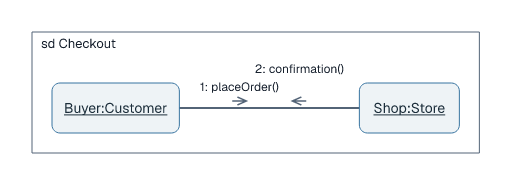
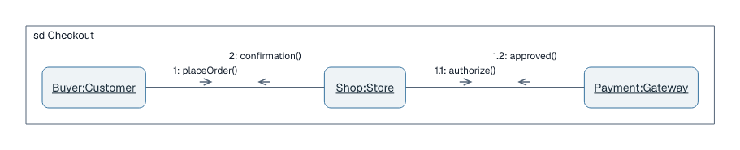

# Communication diagrams

## Basic example

```laml
settings {
    type: communication
    interaction: Checkout
}
semantics {
    object Buyer(of=Customer)
    object Shop(of=Store)
    Buyer -- Shop
    message 1 Buyer --> Shop : placeOrder()
    message 2 Shop --> Buyer : confirmation()
}
layout {
    Buyer < Shop : gap=180
}
```

<picture>
  <source media="(prefers-color-scheme: dark)" srcset="../images/communication-quickstart-modern-dark.png">
  
</picture>

[Complete source](../../examples/communication-quickstart.laml). Declare a link with `--`; numbered messages can travel in either direction on it. `interaction` names the enclosing frame.

## Multiple links and nested numbering

```laml
// Excerpts from examples/communication-order.laml
semantics {
    // […]
    Buyer -- Shop
    Shop -- Payment
    message 1 Buyer --> Shop : placeOrder()
    message 1.1 Shop --> Payment : authorize()
    message 1.2 Payment --> Shop : approved()
    message 2 Shop --> Buyer : confirmation()
}
```

<picture>
  <source media="(prefers-color-scheme: dark)" srcset="../images/communication-order-modern-dark.png">
  
</picture>

[Complete source](../../examples/communication-order.laml). Declare links before their messages. Write message numbers explicitly in the source.

| Form | Use |
|---|---|
| `object A(of=Type)` | Typed participant. |
| `A -- B` | Communication link. |
| `message 1.1 A --> B : action()` | Numbered message on that link. |

Shared placement and styling: [GNE](gne.md). [Full syntax](../language-reference.md#communication-diagrams).
