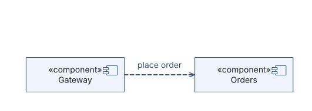
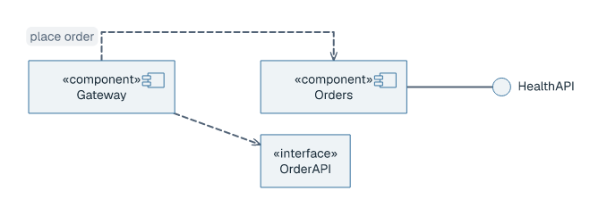
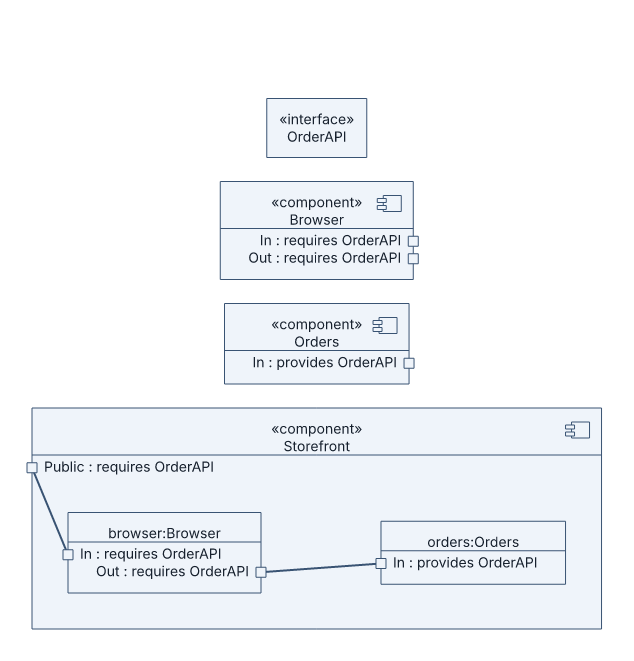
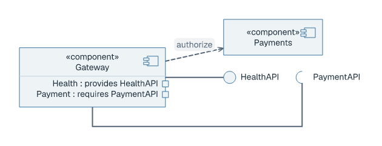

# Component diagrams

## Basic example

```laml
settings {
    type: component
}
semantics {
    component Gateway
    component Orders
    @calls Gateway ..> Orders : place order
}
layout {
    Gateway < Orders : gap=120
}
```



[Complete source](../../examples/component-quickstart.laml). `..>` draws a dependency; `layout` requires the components to keep their separation.

## Interfaces

```laml
// Excerpt from examples/component-basic.laml
semantics {
    // […]
    interface OrderAPI
    interface HealthAPI
    @requires Gateway ..> OrderAPI
    @provides Orders ..|> HealthAPI
}
```



[Complete source](../../examples/component-basic.laml). `..>` points to a required interface box; `..|>` is a provided realization. The source chooses `interface-notation: lollipop` for the provided interface.

## Ports and internal connections

```laml
// Excerpts from examples/component-internal.laml
semantics {
    // […]
    component Storefront {
        port Public(requires=OrderAPI)
        part browser(of=Browser)
        part orders(of=Orders)
        @assembly browser::Out == orders::In
        @delegation Storefront::Public => browser::In
    }
}
```



[Complete source](../../examples/component-internal.laml).

| Form | Meaning |
|---|---|
| `port P(provides=Interface)` / `port P(requires=Interface)` | Typed boundary port. |
| `partA::out == partB::in` | Assembly: opposite-role compatible ports. |
| `Owner::outer => part::inner` | Delegation: same-role ports. |
| `interface-notation: lollipop` / `socket` | Compact provided / required interface. |

## Provided and required compact interfaces

```laml
// Excerpt from examples/component-interfaces.laml
styling {
    relation[provides] {
        interface-notation: lollipop
    }
    relation[requires] {
        interface-notation: socket
    }
}
```



[Complete source](../../examples/component-interfaces.laml). The compact forms are selected on named interface relations; typed ports remain independently addressable.

For common positioning and styling: [GNE](gne.md). [Full syntax](../language-reference.md#component-diagrams).
