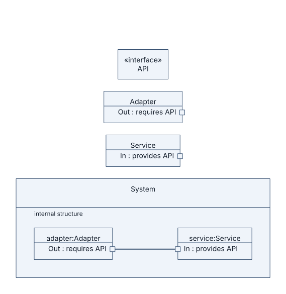
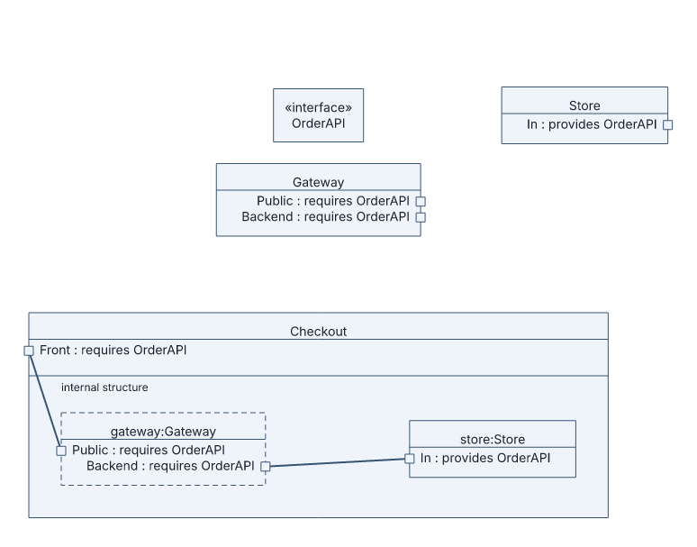

# Composite-structure diagrams

## Basic example

```laml
settings {
    type: composite
}
semantics {
    interface API
    class Adapter {
        port Out(requires=API)
    }
    class Service {
        port In(provides=API)
    }
    structure System {
        part adapter(of=Adapter)
        part service(of=Service)
        @wire adapter::Out == service::In
    }
}
layout {
    System.adapter < System.service : gap=130
}
```



[Complete source for this image](../../examples/composite-basic.laml). `part` creates an owned internal instance of a declared class. `==` joins compatible required and provided ports. The structure contains a visible internal-structure compartment.

## Reference roles and delegation

```laml
// Excerpts from examples/composite-checkout.laml
semantics {
    // […]
    structure Checkout {
        port Front(requires=OrderAPI)
        role gateway(of=Gateway)
        part store(of=Store)
        @external Checkout::Front => gateway::Public
        @internal gateway::Backend == store::In
    }
}
```



[Complete source](../../examples/composite-checkout.laml). A `role` is shown with a dashed outline; `=>` connects a boundary port to a matching same-role internal port.

| Form | Use |
|---|---|
| `part id(of=Class)` / `role id(of=Class)` | Owned part / referenced role. |
| `port P(requires=I)` / `port P(provides=I)` | Typed boundary port. |
| `A::out == B::in` | Assembly between compatible opposite-role ports. |
| `Owner::outer => A::inner` | Delegation to a compatible same-role port. |
| `port[Owner::P] : side=left` | Fix a port's visible side in `layout`. |

Common positioning and styling: [GNE](gne.md). [Full syntax](../language-reference.md#composite-structure-diagrams).
