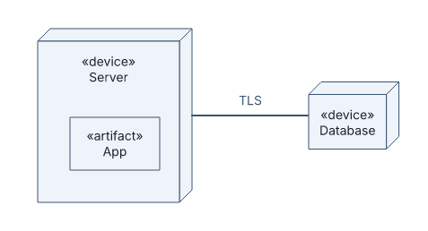
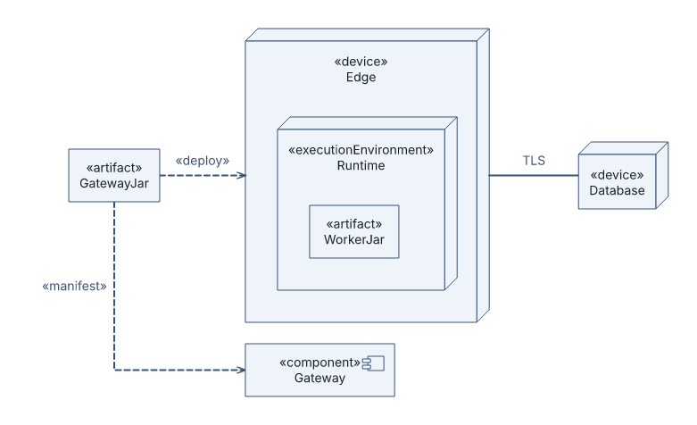
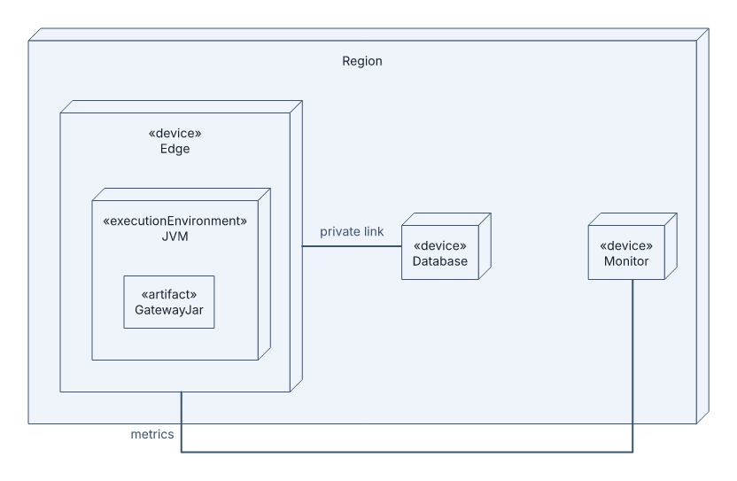
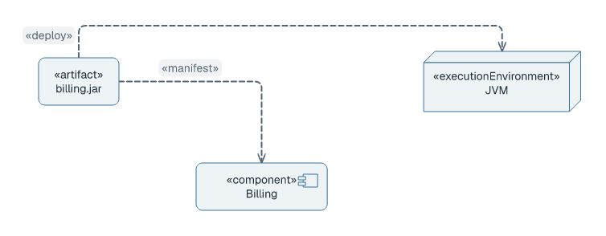

# Deployment diagrams

## Basic example

```laml
settings {
    type: deployment
}
semantics {
    device Server {
        artifact App
    }
    device Database
    Server -- Database : TLS
}
layout {
    Server < Database : gap=130
}
```



[Complete source](../../examples/deployment-quickstart.laml). The artifact is drawn inside its device; `--` connects devices with a communication path.

## Nested topology, deployment and manifestation

```laml
// Excerpts from examples/deployment-basic.laml
semantics {
    device Edge {
        executionEnvironment Runtime {
            artifact WorkerJar
        }
    }
    // […]
    @runs GatewayJar ..> Edge <<deploy>>
    @realizes GatewayJar ..> Gateway <<manifest>>
}
```



[Complete source](../../examples/deployment-basic.laml). `<<deploy>>` points to a deployment target; `<<manifest>>` points to the component realized by an artifact.

```laml
// Excerpt from examples/deployment-topology.laml
semantics {
    node Region {
        device Edge {
            executionEnvironment JVM {
                artifact GatewayJar
            }
        }
        device Database
        device Monitor
        @database Edge -- Database : private link
        @metrics Edge -- Monitor : metrics
    }
}
```



[Complete source](../../examples/deployment-topology.laml).

## Deployment versus manifestation

```laml
// Excerpt from examples/deployment-manifest.laml
component Billing
artifact BillingJar(label="billing.jar")
executionEnvironment JVM
@manifestation BillingJar ..> Billing <<manifest>>
@deployment BillingJar ..> JVM <<deploy>>
```



[Complete source](../../examples/deployment-manifest.laml). Manifestation points to a component; deployment points to a node or execution environment. Use [GNE](gne.md) for shared placement and styling. [Full deployment syntax](../language-reference.md#deployment-diagrams).
