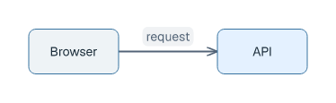
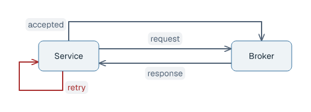
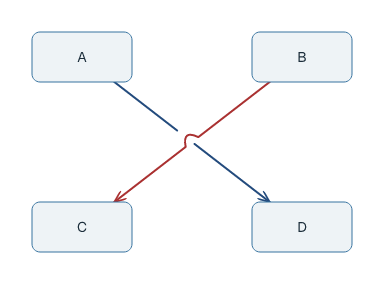
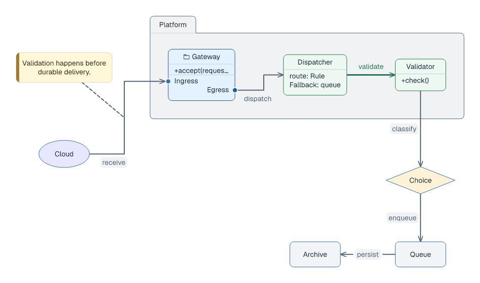
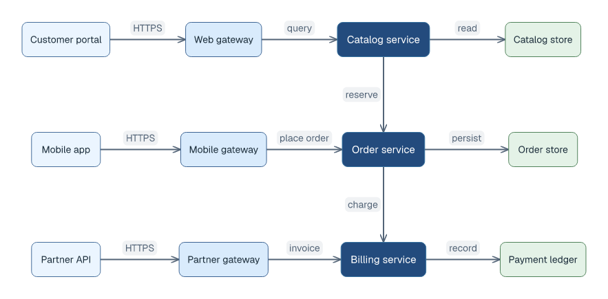
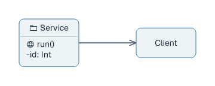
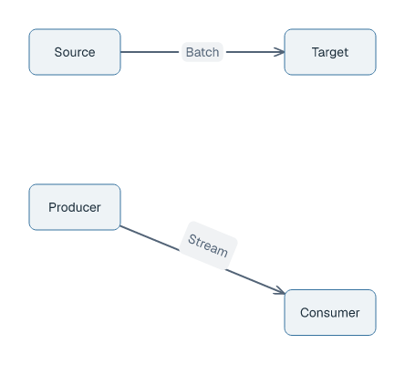

# Generic node-edge diagrams (GNE)

## Basic example

```laml
semantics {
    Browser
    API
    Browser -> API : request
}
layout {
    Browser < API : align=center; gap=110
}
styling {
    node[API] {
        fill: "#e4f1ff"
    }
}
```



[Complete source for this image](../../examples/gne-basic.laml). Build with `laml build examples/gne-basic.laml`. GNE is the default: no `type` setting is needed. The relation gives an automatic placement preference; the layout rule requires a minimum gap and aligned centers.

## Elements and relations

Declare an element by ID (`Service`), optionally with `label="..."` and `style-classes=...`. Name a relation to address it in layout or styling (`sent:` or `@sent`).

| Relation | Meaning |
|---|---|
| `A -> B : text` | Directed A to B, with a visible label. |
| `A <- B` | Directed B to A. |
| `A <-> B` | Both directions. |
| `A -- B` | Undirected. |
| `A -> A` | Self-loop. |

## Parallel relations and self-loops

```laml
// Excerpts from examples/parallel-loops.laml
semantics {
    // […]
    sent: Service -> Broker : request
    accepted: Service -> Broker : accepted
    reply: Broker -> Service : response
    retry: Service -> Service : retry
}
```



[Complete source](../../examples/parallel-loops.laml). Named relations can be styled individually; multiple connections use separate routes.

## Placement and routing

Placement rules constrain **boxes**, not the ends of arrows. Relations guide automatic placement, but do not override mandatory rules.

```laml
// Excerpt from examples/crossing.laml (layout)
layout {
    A < B : align=top; gap=120
    C < D : align=top; gap=120
    A above C : align=left; gap=120
    B above D : align=left; gap=120
}
```



[Complete source for this image](../../examples/crossing.laml).

| Rule | Effect |
|---|---|
| `A < B` / `A left of B` | A left of B. `>` reverses it. |
| `A above B` / `A ^ B` | A above B. `below` / `v` reverses it. |
| `gap=120` | Minimum empty space between boxes. |
| `align=center`, `align=top` or `align=left` | Align on the perpendicular axis; left/right placement accepts `top`, `center`, `bottom`; above/below accepts `left`, `center`, `right`. |

Parallel relations get separate routes; supported crossings draw a bridge, as above. The bridge arches upward on predominantly horizontal relations (including the diagonal shown), or leftward on predominantly vertical ones, regardless of arrow direction. Impossible placement or unsafe routing fails during `build`.

## Shapes, containers and styling

```laml
// Excerpts from examples/showcase-generic.laml
semantics {
    // […]
    package Platform {
        @gateway Gateway(style-classes=entry) {
            @input port Ingress
            @output port Egress
        }
        // […]
    }
    // […]
}
styling {
    // […]
    node.entry {
        icon: "folder"
        fill: "#e4f1ff"
        border-color: "#235784"
    }
    node.decision {
        shape: diamond
        fill: "#fff2d6"
    }
    // […]
}
```



[Complete source for this image](../../examples/showcase-generic.laml). `node.class` selects a styling class; `node[ID]` selects one element. Generic shapes include `rectangle`, `ellipse`, `diamond` and `note`. In modern themes, a GNE note is a rounded card with a flush, full-height left accent, not a folded-paper icon; `plain` keeps the folded note. Modern arrowheads meet the visible edge of generic port dots instead of being covered by them. Packages group contained elements; members and ports can be addressed by relations.

| Selector or property | Use |
|---|---|
| `node.service`, `relation.protocol` | Match elements with a styling class. |
| `node[Service]`, `relation[sent]` | Match an individual element or named relation. |
| `node[Platform] node[Gateway]` | Match inside a container. |
| `fill`, `border-color`, `color` | Box, border and text/stroke colors. |
| `shape`, `icon` | Generic node shape or optional icon. |
| `font-size`, `padding`, `width`, `height` | Size text or geometry; explicit width/height are fixed. |

## Local style files and direction

```laml
// Excerpts from examples/architecture.laml
settings {
    direction: left-to-right
}
styling {
    import "architecture.lamlstyle"
    node.service {
        fill: rgb(35, 75, 125)
        color: rgb(255, 255, 255)
    }
    // […]
}
```



[Full diagram source](../../examples/architecture.laml) · [Imported style file](../../examples/architecture.lamlstyle). `direction` guides unconstrained placement; it does not override mandatory layout. Imports resolve relative to the source file.

## Optional icons and member symbols

```laml
// Excerpts from examples/generic-icons.laml
semantics {
    Service {
        +run()
        -id: Int
    }
    // […]
}
styling {
    * {
        symbol-rendering: icons
        icon-set: phosphor
    }
    node[Service] {
        icon: "folder"
    }
    member[Service::id] {
        symbol-rendering: text
    }
}
```



[Complete source](../../examples/generic-icons.laml). `symbol-rendering: text` overrides icon rendering for one named member.

## Relation labels

```laml
// Excerpts from examples/label-modes.laml
settings {
    relation-label: inline
}
layout {
    // […]
    relation[along] : label=along
}
```



[Complete source](../../examples/label-modes.laml).

| Mode | Drawing |
|---|---|
| `near` | Horizontal label beside its route (default). |
| `along` | Label follows an eligible straight segment. |
| `inline` | Horizontal label in a gap in its route. |

Use `settings` for the default; override a named relation in `layout`. For required relation-end or port sides, see [layout in the language reference](../language-reference.md#layout).
