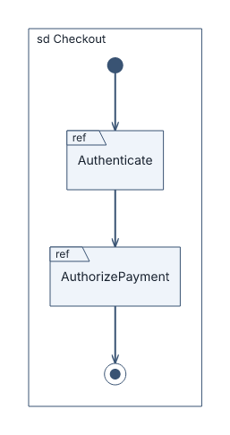
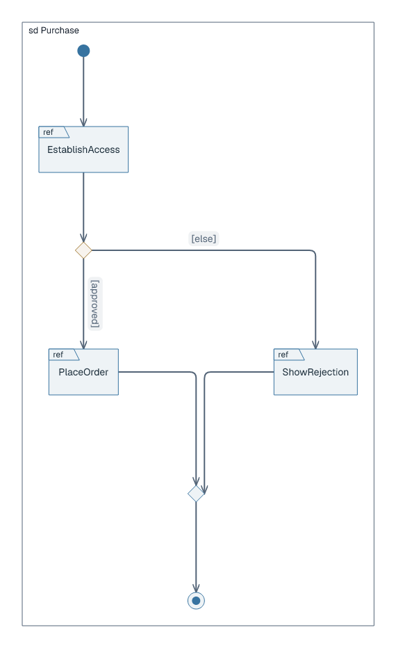
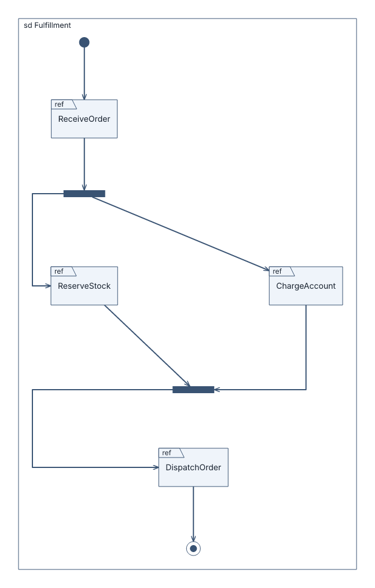

# Interaction-overview diagrams

## Basic example

```laml
settings {
    type: interaction-overview
    interaction: Checkout
    direction: top-to-bottom
}
semantics {
    initial Start
    interaction-use SignIn(ref=Authenticate)
    interaction-use Pay(ref=AuthorizePayment)
    final Done

    Start --> SignIn
    SignIn --> Pay
    Pay --> Done
}
```



[Complete source for this image](../../examples/interaction-overview-basic.laml). Each `interaction-use` is a `ref` frame; directed control flows connect the frames between initial and final vertices.

## Alternative paths

```laml
// Excerpts from examples/interaction-overview-purchase.laml
semantics {
    // […]
    decision Authorized
    interaction-use Order(ref=PlaceOrder)
    interaction-use Reject(ref=ShowRejection)
    merge Outcome
    // […]
    @approved Authorized --> Order : [approved]
    @otherwise Authorized --> Reject : [else]
    Order --> Outcome
    @rejoin Reject --> Outcome
    // […]
}
```



[Complete source](../../examples/interaction-overview-purchase.laml). `decision` branches on guards; `merge` reunites the paths.

## Parallel paths

```laml
// Excerpts from examples/interaction-overview-parallel.laml
Parallel --> Reserve
Parallel --> Charge
Reserve --> Complete
Charge --> Complete
```



[Complete source](../../examples/interaction-overview-parallel.laml). `fork` and `join` delimit parallel paths. Common placement: [GNE](gne.md). [Full syntax](../language-reference.md#interaction-overview-diagrams).
