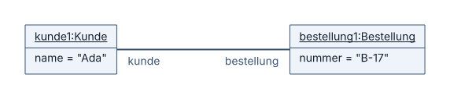
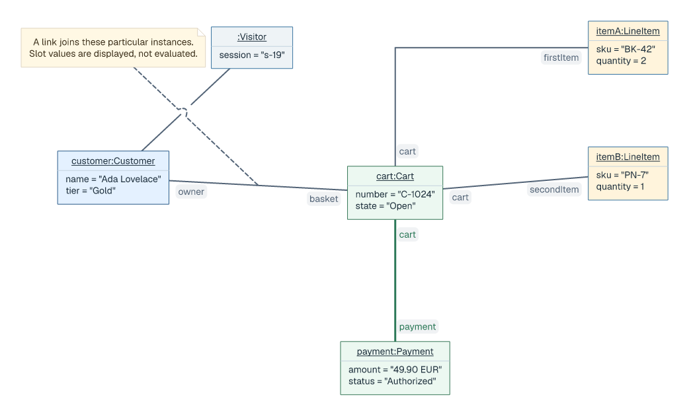

# Object diagrams

## Basic example

```laml
settings {
    type: object
}
semantics {
    kunde1(of=Kunde) {
        name = "Ada"
    }
    bestellung1(of=Bestellung) {
        nummer = "B-17"
    }
    kunde1 /kunde -- /bestellung bestellung1
}
layout {
    kunde1 < bestellung1 : gap=220
}
```



[Complete source for this image](../../examples/object-basic.laml). An object has an underlined instance header; slots display values. Links can show end names.

## Instances, links and styling

```laml
// Excerpts from examples/showcase-object.laml
semantics {
    // […]
    @visitor anonymous object(of=Visitor) {
        session = "s-19"
    }
    @owns customer /owner -- /basket cart
    // […]
    Snapshot .. relation[owns]
}
styling {
    // […]
    relation[settled] {
        color: "#2b7857"
        width: 3
    }
}
```



[Complete source](../../examples/showcase-object.laml). Use named links to target individual styling or attach a note; scope styling with `node[ID]` and `relation[ID]`. Unlike class associations, object links do not carry multiplicities. For common placement and styling, see [GNE](gne.md); for instance forms, see the [language reference](../language-reference.md#class-and-object-diagrams).
