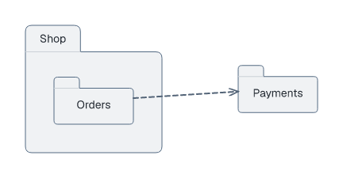
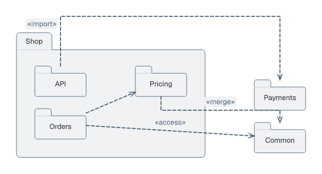

# Package diagrams

## Basic example

```laml
settings {
    type: package
}
semantics {
    package Shop {
        package Orders
    }
    package Payments
    Shop.Orders ..> Payments
}
```

<picture>
  <source media="(prefers-color-scheme: dark)" srcset="../images/package-quickstart-modern-dark.png">
  
</picture>

[Complete source](../../examples/package-quickstart.laml). Braces enclose a package; `Shop.Orders` addresses its nested package. `..>` is a dependency.

## Imports, access and merge

```laml
// Excerpts from examples/package-architecture.laml
semantics {
    // […]
    Shop.API ..> Payments <<import>>
    Shop.Orders ..> Common <<access>>
    Shop.Pricing ..> Common <<merge>>
}
```

<picture>
  <source media="(prefers-color-scheme: dark)" srcset="../images/package-architecture-modern-dark.png">
  
</picture>

[Complete source](../../examples/package-architecture.laml).

| Form | Drawing |
|---|---|
| `package Name` | Leaf package. |
| `package Name { ... }` | Container package (body on separate lines). |
| `A ..> B` | Dependency. |
| `A ..> B <<import>>` | Public package import. |
| `A ..> B <<access>>` | Private package access. |
| `A ..> B <<merge>>` | Package merge. |

Placement, routes and LSS selectors: [GNE](gne.md). [Full syntax](../language-reference.md#package-diagrams).
