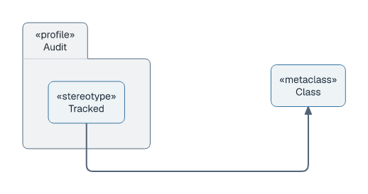

# Profile diagrams

## Basic example

```laml
settings {
    type: profile
}
semantics {
    profile Audit {
        stereotype Tracked
    }
    metaclass Class
    Audit.Tracked --^> Class
}
layout {
    Audit < Class : gap=170
}
```

<picture>
  <source media="(prefers-color-scheme: dark)" srcset="../images/profile-quickstart-modern-dark.png">
  
</picture>

[Complete source](../../examples/profile-quickstart.laml). A profile owns stereotypes. `--^>` draws the filled-triangle extension from a stereotype to a metaclass.

## References and applications

```laml
// Excerpts from examples/profile-audit.laml
semantics {
    // […]
    package Commerce
    Audit.Tracked --^> Class
    Audit ..> Class <<reference>>
    Commerce ..> Audit <<apply>>
}
```

<picture>
  <source media="(prefers-color-scheme: dark)" srcset="../images/profile-audit-modern-dark.png?v=ea7813c">
  
</picture>

[Complete source](../../examples/profile-audit.laml).

| Form | Drawing |
|---|---|
| `profile P {` then `stereotype S` on its own line | Profile and owned stereotype. |
| `P.S --^> Class` | Stereotype extension to a metaclass. |
| `P ..> Class <<reference>>` | Metaclass reference. |
| `Package ..> P <<apply>>` | Profile application. |

Shared placement and styling: [GNE](gne.md). [Full syntax](../language-reference.md#profile-diagrams).
