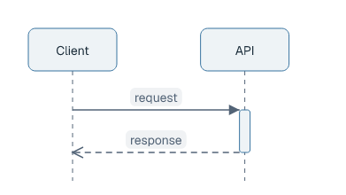
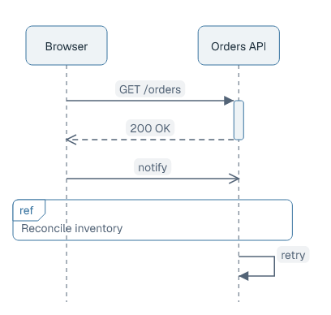
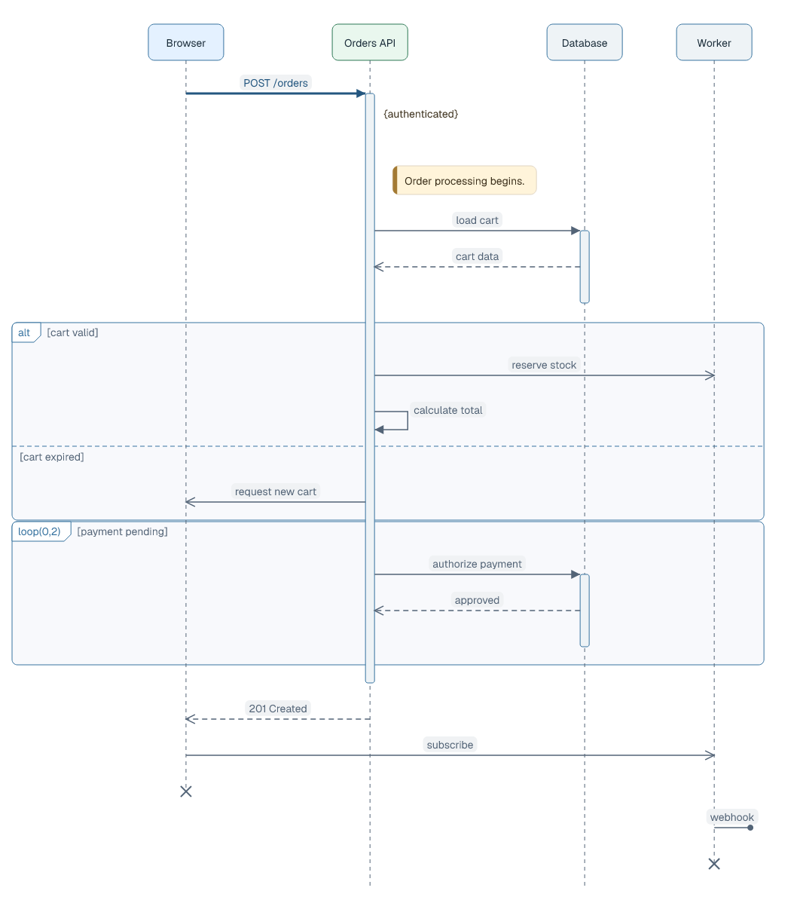
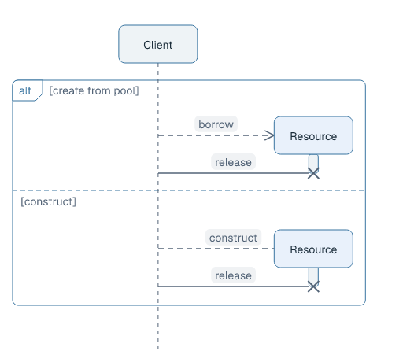
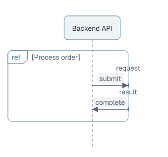
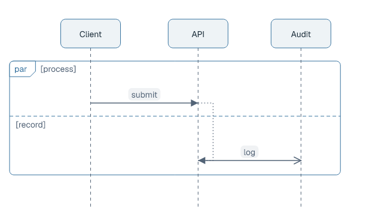
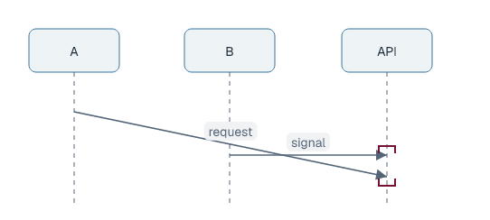
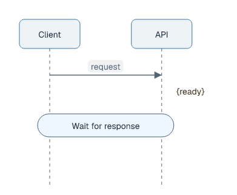
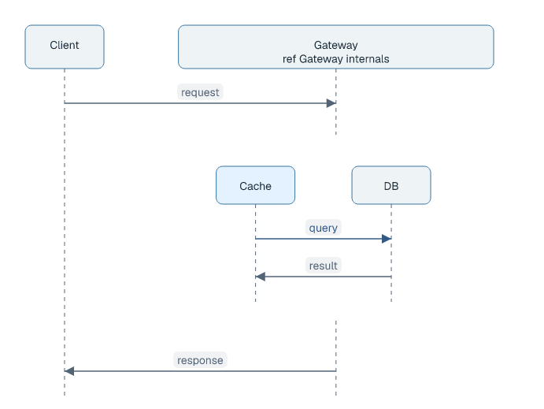

# Sequence diagrams

## Basic example

```laml
settings {
    type: sequence
}
semantics {
    Client
    API
    Client -> API+ : request
    <-- : response
}
layout {
    Client < API : gap=80
}
```



[Complete source](../../examples/sequence-quickstart.laml). `+` opens an execution; `<--` replies to the last unambiguous open call. The participant declarations draw heads and lifelines.

## More messages and an interaction use

```laml
// Excerpts from examples/sequence-basic.laml
Client -> API+ : GET /orders
<-- : 200 OK
Client ->> API : notify
ref "Reconcile inventory"
API -> API : retry
```



[Complete source](../../examples/sequence-basic.laml). `->>` is asynchronous; `ref` draws a named interaction-use frame, and `API -> API` is a self-message.

## Messages, fragments and annotations

```laml
// Excerpts from examples/showcase-sequence.laml
@request Browser -> API+ : POST /orders
at[request.receive] : invariant="authenticated"
// […]
alt "cart valid" {
    @reserve API ->> Worker : reserve stock
    API -> API : calculate total
}
else "cart expired" {
    API ->> Browser : request new cart
}
```



[Complete source for this image](../../examples/showcase-sequence.laml). Name a message to attach an annotation to its `.send` or `.receive` end; use `alt`/`else` for alternatives and `loop` for repetition. The [interaction-use example](../../examples/sequence-basic.laml) shows `ref`.

| Form | Meaning |
|---|---|
| `A -> B : call` | Synchronous message. |
| `A ->> B : signal` | Asynchronous message. |
| `A <-- B : result` / `<-- : result` | Reply. |
| `B+` / `B-` | Open / close an execution. |
| `A -> B! : delete` | Destroy B. |
| `? -> A` / `A -> ?` | Found / lost message. |

## Creation and destruction inside alternatives

```laml
// Excerpt from examples/sequence-alternative-births.laml
alt "create from pool" {
    (kind=create): Client -> Resource+ : borrow
    Client -> Resource! : release
}
else "construct" {
    (kind=create): Client -> Resource+ : construct
    Client -> Resource! : release
}
```



[Complete source](../../examples/sequence-alternative-births.laml). `kind=create` chooses the creation arrow; `!` ends a lifeline with an X.

## Notes, measurements and styling

```laml
// Excerpts from examples/showcase-sequence.laml
semantics {
    // […]
    hint: note "Order processing begins."
    at[request.receive] : invariant="authenticated"
    // […]
}
layout {
    // […]
    hint right of API : gap=12
}
```


[Complete source](../../examples/showcase-sequence.laml). With the default `modern` theme, participant heads, activations and fragment frames have softened corners; message labels use subtle pills, and notes use the same full-height accent card as generic diagrams. `plain` retains the previous outlines. Name a note in `semantics` and place it in `layout`; `right of` places it beside a participant without a connector. For time and duration annotations, see the [annotation example](../../examples/sequence-annotations.laml).

| Fragment | Use |
|---|---|
| `alt` / `else`, `opt` | Alternative / optional operand. |
| `loop(min=0; max=2; guard="...")` | Display repetition bounds and guard. |
| `par` / `and` | Parallel operands. |
| `ref "Name"` | Interaction-use frame. |

## Frame gates and event ordering

```laml
// Excerpt from examples/sequence-gates.laml
ref "Process order" {
    API -> gate[request] : submit
    gate[result] -> API : complete
}
```



[Complete gate source](../../examples/sequence-gates.laml). A named gate attaches a message to the `ref` boundary.

```laml
// Excerpts from examples/sequence-order.laml
par "process" {
    request: Client -> API : submit
}
and "record" {
    logged: API ->> Audit : log
}
order[request.receive,logged.send]
```



[Complete ordering source](../../examples/sequence-order.laml). `order[...]` draws an explicit general-ordering link between named occurrences.

## Coregions, continuations and decomposition

```laml
// Excerpts from examples/sequence-coregion.laml
coregion API {
    first.receive
    second.receive
}
// In layout:
second.receive above first.receive
```



[Complete coregion source](../../examples/sequence-coregion.laml). A coregion groups occurrences on one lifeline; `above` fixes their displayed order.

```laml
// Excerpts from examples/sequence-continuation.laml
condition: continuation "Wait for response"
// In layout:
condition spans Client,API : gap=16
```



[Complete continuation source](../../examples/sequence-continuation.laml). Define the continuation in `semantics`; position it with `spans` in `layout`.

```laml
// Excerpts from examples/sequence-decomposition.laml
decompose API "Gateway internals" {
    Cache
    DB
    query: Cache -> DB : query
    DB -> Cache : result
}
// In layout:
API.Cache < API.DB : gap=36
```



[Complete decomposition source](../../examples/sequence-decomposition.laml). Root layout addresses child lifelines through qualified IDs. For additional operator and styling options, see the [syntax reference](../language-reference.md#sequence-diagrams). Sequence styling can target `lifeline`, `activation`, `fragment`, `note`, `annotation` and `continuation`, alongside `node` and `relation`. [Shared source sections and styling](gne.md).
