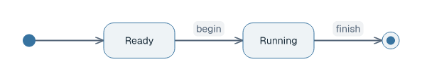
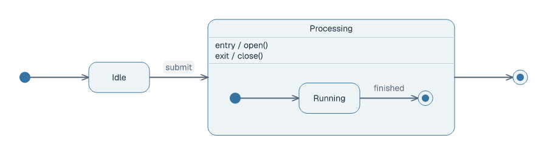

# State diagrams

## Basic example

```laml
settings {
    type: state
}
semantics {
    initial Start
    state Ready
    state Running
    final Done
    Start --> Ready
    Ready --> Running : begin
    Running --> Done : finish
}
```

<picture>
  <source media="(prefers-color-scheme: dark)" srcset="../images/state-quickstart-modern-dark.png">
  
</picture>

[Complete source](../../examples/state-quickstart.laml). `-->` draws a transition; the text after `:` appears beside it.

## Choice, guards and state behavior

```laml
// Excerpts from examples/state-basic.laml
semantics {
    // […]
    choice Check
    state Active {
        entry / startSession()
        do / awaitWork()
        exit / stopSession()
    }
    // […]
    @accept Check --> Active : [valid]
    @retry Check --> Idle : [else]
}
```

<picture>
  <source media="(prefers-color-scheme: dark)" srcset="../images/state-basic-modern-dark.png?v=ea7813c">
  
</picture>

[Complete source](../../examples/state-basic.laml). Guards label choice exits; `entry`, `do`, and `exit` appear inside a state.

## Composite state and self-transition

```laml
// Excerpt from examples/state-composite.laml (semantics)
state Processing {
    entry / open()
    exit / close()
    initial Begin
    state Running
    final Complete
    Begin --> Running
    Running --> Complete : finished
}
```

<picture>
  <source media="(prefers-color-scheme: dark)" srcset="../images/state-composite-modern-dark.png">
  
</picture>

[Composite source](../../examples/state-composite.laml). A state may contain one visible nested region.

```laml
// Excerpt from examples/state-loop.laml
@ping Open --> Open : ping / keepAlive()
```

<picture>
  <source media="(prefers-color-scheme: dark)" srcset="../images/state-loop-modern-dark.png?v=ea7813c">
  
</picture>

[Complete self-loop source](../../examples/state-loop.laml). A self-transition uses `A --> A` and routes outside the state.

For placement and styling see [GNE](gne.md). [Full syntax](../language-reference.md#state-diagrams).
