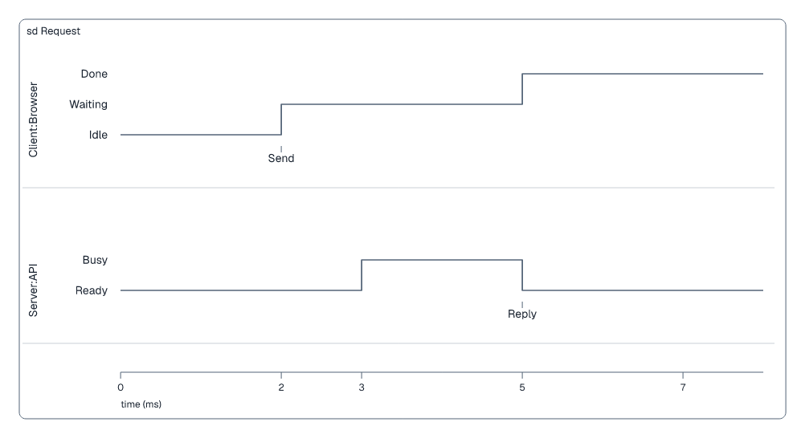
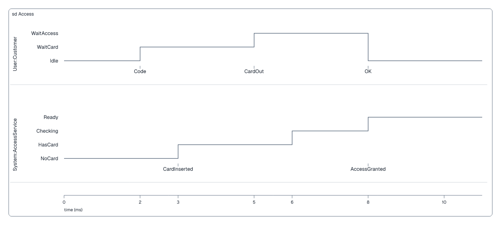

# Timing diagrams

## Basic example

```laml
settings {
    type: timing
    interaction: Request
    time-unit: ms
}
semantics {
    lifeline Client(of=Browser) : Idle
    state Client at 2 : Waiting
    state Client at 5 : Done
    event Client at 2 : Send

    lifeline Server(of=API) : Ready
    state Server at 3 : Busy
    state Server at 5 : Ready
    event Server at 5 : Reply
}
layout {
    scale: 100
    lane-gap: 62
    end: 8
    tick 0
    tick 2
    tick 3
    tick 5
    tick 7
}
```

<picture>
  <source media="(prefers-color-scheme: dark)" srcset="../images/timing-basic-modern-dark.png">
  
</picture>

[Complete source for this image](../../examples/timing-basic.laml). A lifeline starts in its declared state; `state ... at` changes it at a numeric time, and `event ... at` adds visible text. Both lifelines share one ruler.

## More state changes and ruler options

```laml
// Excerpts from examples/timing-access.laml
semantics {
    // […]
    state System at 3 : HasCard
    state System at 6 : Checking
    event System at 8 : AccessGranted
}
layout {
    // […]
    scale: 105
    lane-gap: 62
    end: 11
    tick 3
    tick 6
    // […]
}
```

<picture>
  <source media="(prefers-color-scheme: dark)" srcset="../images/timing-access-modern-dark.png">
  
</picture>

[Complete source](../../examples/timing-access.laml).

| Layout entry | Use |
|---|---|
| `scale: 105` | Distance per time unit. |
| `lane-gap: 62` | Distance between lifeline lanes. |
| `end: 11` | Visible end of the ruler; later than every state change and tick. |
| `tick 6` | Ruler tick at time 6. |

[Full timing syntax](../language-reference.md#timing-diagrams).
