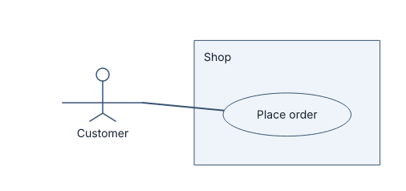
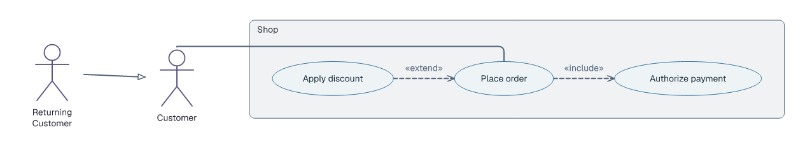

# Use-case diagrams

## Basic example

```laml
settings {
    type: usecase
}
semantics {
    actor Customer
    system Shop {
        usecase Order(label="Place order")
    }
    Customer -- Shop.Order
}
```



[Complete source](../../examples/usecase-quickstart.laml). Declare use cases inside a `system` boundary; connect external actors with `--` and a qualified use-case ID.

## Relationships between use cases and actors

```laml
// Excerpts from examples/usecase-order.laml
semantics {
    // […]
    system Shop {
        // […]
        Order ..> Payment <<include>>
        Discount ..> Order <<extend>>
    }
    // […]
    ReturningCustomer --|> Customer
}
```



[Complete source](../../examples/usecase-order.laml).

| Relation | Use |
|---|---|
| `Actor -- System.UseCase` | Association. |
| `A ..> B <<include>>` | A includes B. |
| `A ..> B <<extend>>` | A extends B. |
| `Special --|> General` | Generalization of same-kind elements. |

Positioning and styling: [GNE](gne.md). [Full syntax](../language-reference.md#use-case-diagrams).
