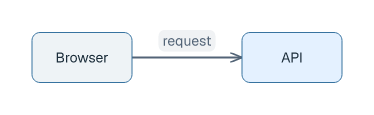

# Getting started

## Install

Linux or macOS:

```sh
curl -fsSL https://raw.githubusercontent.com/farion/laml/main/scripts/install.sh | sh
```

Windows PowerShell:

```powershell
irm https://raw.githubusercontent.com/farion/laml/main/scripts/install.ps1 | iex
```

The installer verifies the downloaded archive against `SHA256SUMS`; a checksum is not a digital signature. Review remote scripts before executing them if your environment requires it. On Windows, open a new terminal after installation. Verify the installation with `laml --version`; run `laml update` when you choose to install a newer release.

## First diagram

Save this as `first.laml` (also available as [a complete source file](../examples/gne-basic.laml)):

```laml
semantics {
    Browser
    API
    Browser -> API : request
}
layout {
    Browser < API : align=center; gap=110
}
styling {
    node[API] {
        fill: "#e4f1ff"
    }
}
```

```sh
laml check first.laml
laml build first.laml
# writes first.svg
laml build first.laml first.png
laml build first.laml first.pdf
```

`check` validates source without producing an image; `build` also checks measured layout and routing. An omitted output filename writes SVG next to the source.

<picture>
  <source media="(prefers-color-scheme: dark)" srcset="images/gne-basic-modern-dark.png">
  
</picture>

This image was built from the [complete source](../examples/gne-basic.laml).

## Basic concepts

| Section | Use |
|---|---|
| `settings` | Diagram type and diagram-wide options; omit `type` for GNE. |
| `semantics` | Elements, relationships, visible labels and identifiers. Required. |
| `layout` | Mandatory placement, alignment and diagram-specific geometry. |
| `styling` | Colors, sizes and shape styling via LSS selectors; local `.lamlstyle` files can be imported. |

The default theme is `modern`; put `theme: plain` in the `settings` section for a more restrained appearance. [Themes and fonts](themes.md) explains the six variants, custom font files, color overrides and transparent exports. Elements named in `semantics` can be addressed in `layout` or `styling`. A relationship describes a connection, not a mandatory position. See [GNE](diagrams/gne.md) for common placement, routing, labels and styling, and the [syntax reference](language-reference.md) for all accepted forms.

## Design principles

**Describe first, constrain sparingly.** LAML arranges the unconstrained parts automatically. `A < B : align=center; gap=110` requires A left of B, vertical-center alignment and at least 110 units between their boxes. It is not a suggestion. Conflicting constraints cause an error rather than a silently different layout. Colors and typography live in `styling`, not in the relationship declaration.

For the same simple connection, the three sources emphasize different things:

| PlantUML | Mermaid | LAML |
|---|---|---|
| `@startuml`<br>`rectangle Browser`<br>`rectangle API`<br>`Browser --> API : request`<br>`@enduml` | `flowchart LR`<br>`Browser -- request --> API` | `Browser -> API : request` in `semantics`<br>`Browser < API : gap=110` in `layout` |

PlantUML also has direction controls; Mermaid supports flow directions, layout configuration and invisible links. The distinction is **not** that other tools cannot influence layout. LAML expresses the required box separation independently of the relationship: the rule is checked against measured geometry. [See the crossing and its complete source](diagrams/gne.md#placement-and-routing). Syntax references: [PlantUML](https://plantuml.com/deployment-diagram) · [Mermaid flowcharts](https://mermaid.js.org/syntax/flowchart.html).

## Diagram types

The lines in the middle column are **syntax excerpts**, not complete files. Follow the linked guide for a starting example with its rendered image and complete source.

| Type | At a glance | Guide |
|---|---|---|
| Generic node-edge (GNE) | `A -> B : request` | [GNE](diagrams/gne.md) |
| Class | `class Order { ... }` | [Class](diagrams/class.md) |
| Object | `order1(of=Order)` | [Object](diagrams/object.md) |
| Component | `component Gateway` | [Component](diagrams/component.md) |
| Deployment | `device Edge { ... }` | [Deployment](diagrams/deployment.md) |
| State | `state Idle` | [State](diagrams/state.md) |
| Activity | `action Inspect` | [Activity](diagrams/activity.md) |
| Use case | `usecase Order` | [Use case](diagrams/usecase.md) |
| Package | `package Shop { ... }` | [Package](diagrams/package.md) |
| Sequence | `Client -> API+ : request` | [Sequence](diagrams/sequence.md) |
| Communication | `message 1 Buyer --> Shop : placeOrder()` | [Communication](diagrams/communication.md) |
| Interaction overview | `interaction-use SignIn(ref=EstablishAccess)` | [Interaction overview](diagrams/interaction-overview.md) |
| Timing | `state User at 2 : WaitCard` | [Timing](diagrams/timing.md) |
| Composite structure | `part store(of=Store)` | [Composite structure](diagrams/composite.md) |
| Profile | `profile Audit {` followed by `stereotype Tracked` on the next line | [Profile](diagrams/profile.md) |
| C4 system context | `type: c4-context` and `scope: Shop` | [C4 guide](c4-diagrams.md) |
| C4 container | `type: c4-container` and `container Web(...)` | [C4 guide](c4-diagrams.md) |
| C4 component | `type: c4-component` and `component Orders(...)` | [C4 guide](c4-diagrams.md) |
| C4 code | `type: c4-code` and `class Order { ... }` | [C4 guide](c4-diagrams.md) |
| BPMN process/collaboration | `Review <X> Approve:yes ; Reject:no` | [BPMN](diagrams/bpmn.md) |

For the complete syntax and defaults, use the [language reference](language-reference.md). For compiler behavior, use the [language contract](language-definition.md).
