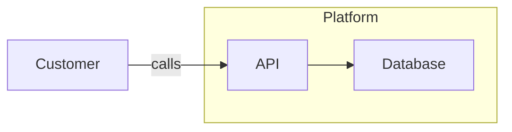
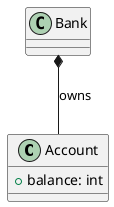

# Import existing diagrams

`laml import` converts Mermaid, PlantUML and Structurizr sources into editable `.laml` files. The original file remains unchanged. Build the converted source with `laml build` and refine its `layout` and `styling` sections as needed.

```sh
laml import architecture.mmd
laml build architecture.laml architecture.svg
laml import domain.puml domain.laml
laml import workspace.dsl diagrams/
laml import workspace.json diagrams/
```

Formats are detected from `.mmd`/`.mermaid`, `.puml`/`.plantuml`/`.pu`, `.dsl` and `.json`. For other extensions, use `--from=mermaid`, `--from=plantuml`, `--from=structurizr-dsl` or `--from=structurizr-json`. Existing output is protected; use `--force` when you intend to replace it. A single-view import writes `SOURCE.laml` by default; a multi-view workspace writes one file per view key to `SOURCE-laml/` or the directory you specify.

## Mermaid

Flowcharts (`flowchart` / `graph`) map to generic diagrams. Node labels, rectangles, ellipses, diamonds, ordinary arrows, undirected lines, edge labels, direction and one level of `subgraph` map to LAML source and package frames. `classDiagram` maps classifiers, members and common UML relationships to a class diagram. `sequenceDiagram` maps participants, messages, replies and explicit activation events to a sequence diagram.



## PlantUML

A single `@startuml` / `@enduml` diagram converts to a class diagram when it declares classifiers or packages, and otherwise to a sequence diagram. The class mapping covers classifier bodies, associations, inheritance, realization, composition, aggregation and one level of packages. The sequence mapping covers participants, synchronous messages, dotted replies and explicit activation events.



## Structurizr

Import a Structurizr DSL workspace or a workspace JSON export. System-context, container and component views become separate C4 `.laml` files, with their named model elements and selected relationships. A DSL workspace can use identifiers, nested software systems/containers/components, directed relationships, `include` and `autoLayout`. The importer derives each diagram from its selected view; LAML then performs its own measured layout.

```text
workspace "Bank" {
    model {
        customer = person "Customer" "Views balances"
        bank = softwareSystem "Bank" "Online banking" {
            api = container "API" "Banking API" "Java"
        }
        customer -> bank "Uses"
        customer -> api "Calls"
    }
    views {
        systemContext bank Context {
            include *
        }
        container bank Containers {
            include customer
            include api
        }
    }
}
```

```sh
laml import bank.dsl
laml build bank-laml/Context.laml
laml build bank-laml/Containers.laml
```

Import errors identify source lines for line-oriented formats. A conversion is checked as LAML before files are written. When a construct needs a distinct semantic or visual mapping, the importer reports it for an explicit decision rather than quietly discarding it. Structurizr views with custom visual styles require such a mapping.
