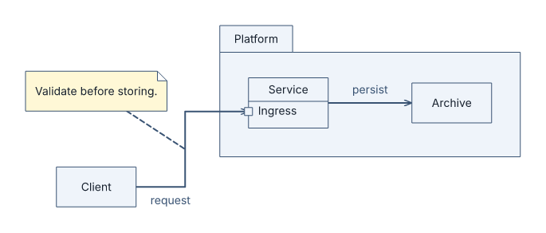
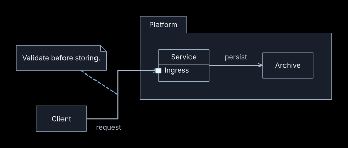

# Themes and fonts

LAML uses `modern` when no theme is specified. The six themes are `plain`, `modern`, `modern-mono`, `plain-dark`, `modern-dark`, and `modern-mono-dark`.

```laml
settings {
    theme: modern-dark
    background: transparent
}
semantics {
    Service
    Database
    Service -> Database : persist
}
styling {
    node[Service] {
        base-color: "#128575"
    }
    node[Database] {
        fill: "#ffffff"
        color: "#182330"
    }
}
```

## Visual comparison

These six diagrams share the same semantics and layout and use theme-default colors. Each image has a complete [source file](../examples/theme-modern.laml); switch the filename's theme suffix to inspect the other five.

| Style | Light | Dark |
|---|---|---|
| Plain |  |  |
| Modern |  |  |
| Modern mono |  |  |

`plain` uses restrained styling and bundled Inter typography. Modern notes in GNE, class/object and sequence diagrams are rounded cards without a folded corner; their accent spans the full left edge. `plain` notes keep the folded shape. Modern classifier boxes, sequence participant heads, activation bars and combined-fragment frames also gain measured corner radii without changing their notation or layout. Modern open arrowheads are slightly larger. Arrows entering a named port meet its visible rim: round for modern generic ports, square for plain and UML ports. `modern` uses bundled Geist Sans, pale tinted nodes and a quieter edge palette. `modern-mono` uses grayscale theme defaults and bundled Geist Sans. Any explicit LSS color remains in force, even in a mono theme. The dark variants use a black (`#000000`) canvas and inverted light/dark paints; `plain` variants use bundled Inter. Modern variants use Geist Sans. Fonts are measured before layout, so changing a theme or font can move text and change node dimensions.

`base-color` defines the hue of a paint family. Fill, border and text use separate, readable lightness and saturation targets; a vivid source color does not become a vivid fill. An explicit `fill`, `border-color`, or `color` replaces **only that one paint**. Thus changing `base-color` updates the remaining derived paints but never erases an explicit override. These properties work in imported `.lamlstyle` files as well. The cascade follows LSS selector precedence. Generic nodes get a blue theme default, packages neutral and notes warm; diagram types retain their own meaningful shapes.

`background` is `opaque` by default: white for light themes, black for dark themes. `background: transparent` leaves the canvas transparent in SVG, PNG and PDF while retaining the chosen theme's element colors. Choose the light or dark theme for the surface where the image will appear. Pair an explicitly styled light fill with a dark `color` for readable text.

To use a locally supplied font, add `font-file: "fonts/MySans-Regular.otf"` and, if available, `font-italic-file: "fonts/MySans-Italic.otf"` to `settings`. Replace these example filenames with your local fonts. Font selection is diagram-wide; `font-size` remains separately adjustable per LSS selector. `font-file` and optional `font-italic-file` take **quoted paths relative to the diagram**. Paths must remain in the diagram's directory tree after resolving symlinks. Supported OpenType fonts are validated when building. If the chosen regular face cannot display a label, build fails; an abstract italic label requires an italic face. The same font bytes are used to measure text and to produce the SVG, PNG and PDF. An embedded SVG remains selectable; `--svg-text=paths` outlines text, and `--svg-text=system` uses the viewer's installed fonts. Users supplying fonts are responsible for the rights to distribute or embed them. Theme fonts are bundled; the Geist OFL notice is in [`assets/GEIST-LICENSE.txt`](../assets/GEIST-LICENSE.txt).
